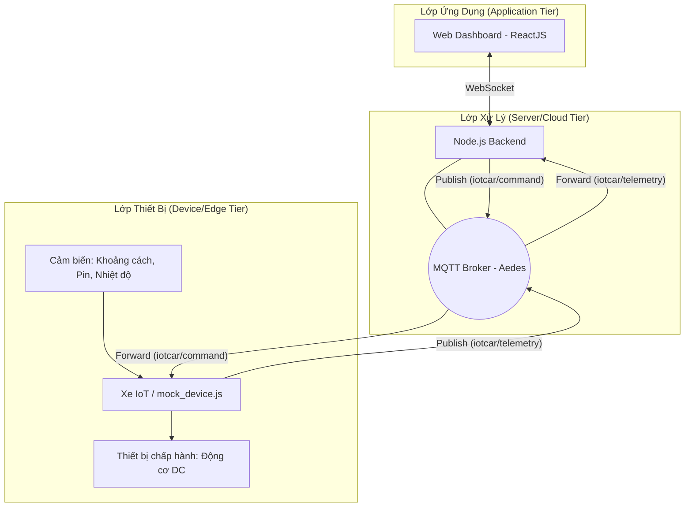

# Báo Cáo Kiến Trúc Hệ Thống IoT Chạy Giao Thức MQTT

Báo cáo này được biên soạn dựa trên cấu trúc mã nguồn thực tế của dự án, cụ thể là sự tương tác giữa Web Dashboard (ReactJS), Backend Server (Node.js) và Module Xe IoT mô phỏng (`mock_device.js`).

---

## Câu 1: Mô hình và Kiến trúc

Hệ thống IoT của nhóm được xây dựng theo **mô hình Publish/Subscribe (Pub/Sub)** tích hợp trong **Kiến trúc 3 lớp (3-Tier Architecture)**.

### Sơ đồ Kiến trúc Hệ thống



### Các lớp chính:
1. **Lớp thiết bị (Device Tier):** Gồm chiếc xe (vi điều khiển ESP32 hoặc script mô phỏng) làm nhiệm vụ đọc cảm biến và điều khiển phần cứng.
2. **Lớp xử lý trung tâm (Server Tier):** Máy chủ Node.js chứa MQTT Broker nội bộ để định tuyến tin nhắn.
3. **Lớp ứng dụng (Application Tier):** Giao diện Web trực quan để người dùng tương tác.

---

## Câu 2: Các thành phần và vai trò trong hệ thống

Dựa vào mã nguồn của dự án, các thành phần đóng vai trò như sau:

1. **Thiết bị cảm biến (Sensors):** Gồm cảm biến siêu âm (đo khoảng cách), cảm biến nhiệt độ và mạch đo điện áp (tính % Pin).
   *Vai trò:* Thu thập các thông số vật lý của xe và môi trường theo thời gian thực (10 lần/giây) để giám sát an toàn.
2. **Thiết bị chấp hành (Actuators):** Hai động cơ DC (Bánh trái và Bánh phải) thông qua IC điều khiển (Mạch cầu H).
   *Vai trò:* Nhận tín hiệu băm xung (PWM) để thực thi hành động vật lý (Tiến, lùi, rẽ trái, phải, phanh khẩn cấp).
3. **Mạng kết nối:** Mạng nội bộ (Wi-Fi/LAN) sử dụng giao thức TCP/IP làm nền tảng.
4. **MQTT Broker:** Là thư viện `aedes` chạy tích hợp bên trong Backend Node.js ở cổng 1883.
   *Vai trò:* Là "Trạm trung chuyển". Nó không quan tâm nội dung tin nhắn là gì, chỉ làm nhiệm vụ nhận bản tin và phân phối đến những thiết bị đã đăng ký (Subscribe) đúng "Chủ đề" (Topic).
5. **Publisher (Bên phát):** 
   * Xe IoT làm Publisher khi phát dữ liệu cảm biến lên topic `iotcar/telemetry`.
   * Node.js làm Publisher khi phát lệnh điều hướng lên topic `iotcar/command`.
6. **Subscriber (Bên thu):** 
   * Xe IoT làm Subscriber khi đăng ký lắng nghe lệnh lái từ topic `iotcar/command`.
   * Node.js làm Subscriber để hứng dữ liệu cảm biến từ topic `iotcar/telemetry`.
7. **Server / Ứng dụng người dùng:** Node.js Backend xử lý logic và đồng bộ trạng thái, trong khi ReactJS Web Dashboard cung cấp bảng điều khiển Joystick ảo, biểu đồ độ trễ (Benchmark Modal) và các thanh cảnh báo an toàn.

---

## Câu 3: Luồng dữ liệu và So sánh MQTT vs HTTP

### Tình huống mô tả Luồng dữ liệu MQTT
**Tình huống:** Người dùng đẩy cần Joystick trên Web App để xe tiến về phía trước.
**Quy trình truyền tải:**
1. **Khởi tạo dữ liệu (Web):** Người dùng đẩy Joystick lên. Ứng dụng Web lập tức bắt sự kiện và gửi chuỗi tọa độ (VD: `X=0, Y=1, Speed=80`) qua kết nối WebSocket nội bộ lên Node.js Server.
2. **Publisher hoạt động (Server):** Node.js Server đóng gói lệnh thành định dạng JSON: `{"x":0, "y":1, "speedLimit":80}`. Sau đó, nó đóng vai trò Publisher gửi cục JSON này vào MQTT Broker với chủ đề (Topic) là `iotcar/command`.
3. **Broker định tuyến:** MQTT Broker nhận bản tin, đối chiếu danh sách và thấy Xe IoT đang Subscribe topic này. Nó lập tức chuyển tiếp bản tin xuống Xe.
4. **Subscriber nhận lệnh và Thực thi (Xe):** Xe nhận được cục JSON, giải mã (parse) và tính toán. Dựa vào công thức động lực học (Forward Kinematics), nó quy đổi Y=1 thành xung `PWM=204` cho cả hai bánh trái/phải. Động cơ nhận điện áp và quay, xe tiến về trước.
5. **Phản hồi (Telemetry):** Khi xe di chuyển, cảm biến siêu âm phát hiện khoảng cách vật cản giảm dần (VD: từ 140cm xuống 130cm). Xe lập tức đóng gói thông số này (Publisher) đẩy vào Topic `iotcar/telemetry`. Server (Subscriber) nhận được và bắn ngược lên Web để hiển thị.

### Sự thay đổi nếu thay thế MQTT bằng HTTP
Nếu dự án dỡ bỏ MQTT và thay bằng HTTP (giống như module `--protocol=http` trong mô phỏng), hệ thống sẽ gặp các biến đổi sau:

1. **Thay đổi về Mô hình:**
   * Không còn MQTT Broker. Hệ thống chuyển sang mô hình **Client-Server (Request/Response)** thuần túy.
2. **Thay đổi về Phương thức trao đổi:**
   * **MQTT (Push):** Kết nối luôn được giữ (Keep-Alive). Khi có lệnh mới, Server chủ động *đẩy (Push)* thẳng xuống xe ngay lập tức.
   * **HTTP (Pull/Polling):** Server không thể chủ động đẩy lệnh xuống xe. Bắt buộc Xe IoT phải liên tục thực hiện vòng lặp **Polling** (Liên tục gửi Request `GET /api/command` lên Server với tần suất hàng chục lần/giây) để hỏi xem *"Có lệnh lái nào mới không?"*.
3. **Hậu quả & Rủi ro (Nhược điểm của HTTP):**
   * **Mất an toàn:** Trễ 300ms nghĩa là khi người dùng thả Joystick để phanh, nửa giây sau xe mới nhận được lệnh. Quãng đường trượt (Overshoot) dài sẽ khiến xe đâm trực diện vào tường, đánh mất sự an toàn của mô hình xe tự hành.

---

## Phụ lục: Minh chứng Source Code Triển khai

### 1. Code triển khai giao thức HTTP (REST API)

**Trên Backend Server (Mở cổng API nhận dữ liệu):**
*   **File:** `backend/server.js`
*   **Mô tả:** Định nghĩa 2 API là `POST /api/telemetry` (để nhận cảm biến từ xe) và `GET /api/command` (để xe kéo lệnh về). Khi có telemetry mới, nó sẽ gọi `io.emit` để bắn lên Web.
```javascript
app.post('/api/telemetry', (req, res) => {
  const telemetry = req.body;
  if (telemetry) {
    latestTelemetry = telemetry;
    io.emit('telemetry_data', telemetry); // Broadcast to frontend
    res.status(200).json({ status: 'success' });
  } else {
    res.status(400).json({ error: 'No data' });
  }
});

app.get('/api/command', (req, res) => {
  res.status(200).json(latestCommand);
});
```

**Trên Xe IoT (Gửi Request liên tục):**
*   **File:** `backend/mock_device.js`
*   **Mô tả:** Hàm `pollHttp()` dùng lệnh `fetch` liên tục gọi API để lấy lệnh điều hướng. Hàm `sendHttpTelemetry()` dùng `POST` để đẩy dữ liệu cảm biến lên Server.
```javascript
async function pollHttp() {
  try {
    const res = await fetch(`${HTTP_URL}/command`);
    if (res.ok) {
      const cmd = await res.json();
      if (cmd.x !== currentX || cmd.y !== currentY || cmd.speedLimit !== currentSpeedLimit) {
        handleCommand(cmd);
      }
    }
  } catch (e) { }
}

async function sendHttpTelemetry(telemetry) {
  try {
    await fetch(`${HTTP_URL}/telemetry`, {
      method: 'POST',
      headers: { 'Content-Type': 'application/json' },
      body: JSON.stringify(telemetry)
    });
  } catch (e) { }
}
```

---

### 2. Code triển khai giao thức MQTT

**Trên Backend Server (Tích hợp MQTT Broker):**
*   **File:** `backend/server.js`
*   **Mô tả:** Dùng thư viện `aedes` để khởi tạo một trạm MQTT Broker ở cổng `1883`. Lắng nghe sự kiện `aedes.on('publish')`. Nếu có ai (xe) bắn tin nhắn vào Topic `iotcar/telemetry`, nó sẽ parse JSON và bắn lên Web. Ngoài ra, Server chủ động dùng `aedes.publish()` đẩy lệnh điều hướng xuống xe.
```javascript
const aedes = await Aedes.createBroker();
const mqttServer = net.createServer(aedes.handle);
mqttServer.listen(1883, function () {
  console.log(`[MQTT] Aedes Broker đang chạy cổng 1883`);
});

// Nhận dữ liệu cảm biến từ xe
aedes.on('publish', function (packet, client) {
  if (client && packet.topic === 'iotcar/telemetry') {
    const telemetry = JSON.parse(packet.payload.toString());
    io.emit('telemetry_data', telemetry);
  }
});

// Phía dưới (trong socket.io), Server đẩy lệnh lái xuống xe:
aedes.publish({ topic: 'iotcar/command', payload: JSON.stringify(command) });
```

**Trên Xe IoT (Kết nối Broker và Đăng ký Topic):**
*   **File:** `backend/mock_device.js`
*   **Mô tả:** Hàm `setupMQTT()` khởi tạo kết nối tới cổng `1883`. Gọi `mqttClient.subscribe('iotcar/command')` để đăng ký lắng nghe lệnh lái. Đồng thời, xe dùng `mqttClient.publish('iotcar/telemetry', ...)` để ném dữ liệu cảm biến lên Broker.
```javascript
function setupMQTT() {
  mqttClient = mqtt.connect(MQTT_URL);

  mqttClient.on('connect', () => {
    // Đăng ký nhận lệnh điều hướng
    mqttClient.subscribe('iotcar/command');
  });

  mqttClient.on('message', (topic, message) => {
    if (topic === 'iotcar/command') {
      const cmd = JSON.parse(message.toString());
      handleCommand(cmd); // Thực thi băm xung động cơ
    }
  });
}

// Bên trong vòng lặp Physics, xe đẩy cảm biến lên Broker:
mqttClient.publish('iotcar/telemetry', JSON.stringify(telemetry));
```
