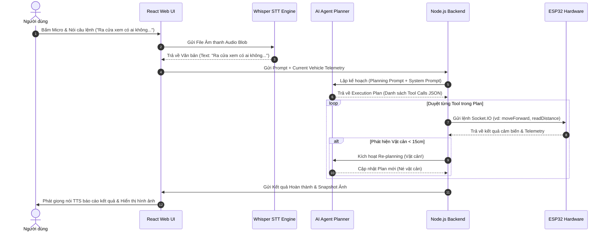

# KẾ HOẠCH TRIỂN KHAI HỆ THỐNG AI AGENTS & ĐIỀU KHIỂN BẰNG GIỌNG NÓI CHO XE ESP32

Tài liệu này chi tiết hóa kế hoạch nâng cấp hệ thống xe ô tô IoT ESP32 sang mô hình **AI Agent điều khiển bằng Ngôn ngữ tự nhiên & Giọng nói (Voice-controlled Autonomous AI Agent)**.

---

## 1. MỤC TIÊU DỰ ÁN

Xây dựng hệ thống xe thông minh đa tầng tích hợp AI Agent với các tính năng:
1. **Điều khiển thủ công & Trực quan (Web Cockpit):** Dashboard React với Virtual Joystick, phím WASD, Cử chỉ tay (Hand Gesture), và Live Camera Stream.
2. **Điều khiển bằng giọng nói (Voice Control):** Thu âm trực tiếp trên Web Browser, chuyển đổi Voice-to-Text (STT) bằng OpenAI Whisper / Web Speech API.
3. **Hiểu ngôn ngữ tự nhiên (Natural Language NLU):** Phân tích câu lệnh từ người dùng thông qua hệ thống Fast-Path Matcher Engine siêu tốc.
4. **Tự lập kế hoạch đa bước (AI Agent Planner):** Áp dụng mô hình **ReAct (Reasoning + Acting)** để chia nhỏ nhiệm vụ thành chuỗi lệnh execution plan.
5. **Thực thi Tool & Theo dõi thời gian thực (Tool Execution & Telemetry Feedback):** AI tương tác với xe thông qua **Tool Manager / Function Calling**, liên tục cập nhật dữ liệu cảm biến (khoảng cách siêu âm, điện áp pin) để điều chỉnh kế hoạch động.

---

## 2. PHẠM VI DỰ ÁN (SCOPE)

### Chức năng Bắt buộc (MVP - Sprints 1 đến 4)
- ✅ **Lái cơ bản:** Điều khiển Tiến / Lùi / Rẽ Trái / Rẽ Phải / Dừng khẩn cấp.
- ✅ **Camera Live Stream:** Phát luồng video MJPEG từ điện thoại (IP Webcam) về Web UI.
- ✅ **Đồng hồ Cảm biến:** Hiển thị điện áp Pin, % Pin, Khoảng cách vật cản (HC-SR04), RSSI WiFi.
- ✅ **Thu âm & STT:** Nút micro trên Web thu âm giọng nói người dùng và chuyển thành văn bản (Text).
- ✅ **Chuyển câu lệnh đơn thành Tool Call:** Nhận diện các lệnh đơn ("Tiến lên", "Rẽ trái", "Bật đèn") và kích hoạt Tool tương ứng ngay lập tức.

### Chức năng Nâng cao (Advanced AI Agent - Sprints 5 đến 7)
- 🚀 **AI Agent Lập kế hoạch đa bước:** Tự phân tích các mục tiêu phức tạp (ví dụ: *"Ra cửa phòng xem có ai không, chụp ảnh rồi báo về"*).
- 🚀 **Tự động né tránh vật cản (Autonomous Obstacle Avoidance):** Luồng điều khiển cấp thấp trên ESP32/Backend tự phanh và điều hướng lại khi HC-SR04 phát hiện vật cản < 15cm trong quá trình AI di chuyển.
- 🚀 **Tự kiểm tra pin & Cảnh báo an toàn (Smart Battery Guard):** Tự hủy nhiệm vụ hoặc tự lùi về vị trí an toàn nếu pin < 20%.
- 🚀 **Chụp ảnh & Phân tích thị giác (Capture Image & Status Report):** Tự trích xuất khung hình từ Camera stream, lưu file snapshot và gửi về giao diện người dùng.
- 🚀 **Phản hồi bằng Giọng nói (Text-to-Speech - TTS):** AI đọc câu trả lời và báo cáo trạng thái công việc bằng giọng nói tiếng Việt mượt mà.

---

## 3. THÀNH PHẦN & STAKEHOLDERS (SYSTEM FLOW)

```
[ Người dùng (Giọng nói / Thao tác Web) ]
                │
                ▼
      ┌──────────────────┐
      │  React Web UI    │ (Microphone / Web Speech / Audio Recorder)
      └────────┬─────────┘
               │ Audio Blob / Text Command (WebSocket / REST)
               ▼
   ┌────────────────────────┐
   │ Node.js Backend Server │ (Broker & Agent Coordinator)
   └───────────┬────────────┘
               │
   ┌───────────┴────────────────────────┐
   │  AI AGENT ENGINE                   │
   │  - Speech-to-Text: Whisper API     │
   │  - LLM Brain: Ollama / Gemini / GPT│
   │  - Agent Planner: ReAct Loop       │
   │  - Tool Registry & Safety Guard    │
   └───────────┬────────────────────────┘
               │ Verified Tool Call JSON (Socket.IO)
               ▼
     ┌──────────────────┐
     │ ESP32 Firmware   │ (FreeRTOS Dual-Core)
     └─────────┬────────┘
               │ GPIO PWM / I2C / ADC
               ▼
[ Động cơ L298N + HC-SR04 + Pin + Camera IP ]
```

---

## 4. KIẾN TRÚC HỆ THỐNG AI AGENT (ARCHITECTURE & PIPELINE)

### Vòng lặp Xử lý AI Agent (AI Agent Execution Cycle):
1. **Audio Capture:** User nhấn giữ Micro trên Web Cockpit $\rightarrow$ Thu âm âm thanh PCM/WAV.
2. **Speech-to-Text (STT):** Gửi Audio Blob sang Whisper Engine (Local Faster-Whisper hoặc OpenAI Whisper API) $\rightarrow$ Trả về văn bản Tiếng Việt.
3. **Agent Reasoning (System Prompt + State Injection):**
   - Inject trạng thái xe hiện tại: `{ battery: 75%, distance: 45cm, is_moving: false }`.
   - Inject Prompt định dạng Tool Calling JSON chuẩn.
4. **Task Planning (Multi-step Tool Sequence):** LLM suy luận và sinh chuỗi kế hoạch (Plan):
   - Step 1: `moveForward(speed=60, duration_ms=2000)`
   - Step 2: `readDistance()`
   - Step 3: `captureImage()`
   - Step 4: `readBattery()`
5. **Execution & Closed-Loop Control:**
   - Backend duyệt từng bước trong Kế hoạch.
   - Trước mỗi bước di chuyển, kiểm tra cờ an toàn (`distance > 15cm`, `battery > 20%`).
   - Gửi lệnh Socket.IO xuống ESP32.
   - Nhận phản hồi Telemetry từ ESP32 $\rightarrow$ Cập nhật Bộ nhớ (Agent Memory).
6. **Final Feedback & TTS:** LLM tổng hợp kết quả nhiệm vụ $\rightarrow$ Sinh câu trả lời $\rightarrow$ Phát ra âm thanh bằng Web Speech Synthesis (TTS).

---

## 5. DANH SÁCH TOOL VÀ CHUẨN JSON SCHEMA CỦA AI

AI Agent không phát xung PWM trực tiếp xuống động cơ mà tương tác thông qua **Hệ thống Tool (Function Calling)** được định nghĩa nghiêm ngặt:

| Tên Tool | Thao tác | Thao số đầu vào | Định dạng Phản hồi |
| :--- | :--- | :--- | :--- |
| `moveForward` | Lái xe tiến tới | `speed` (0-100%), `duration_ms` (ms) | `{ success: true, actual_distance_moved }` |
| `moveBackward` | Lái xe lùi lại | `speed` (0-100%), `duration_ms` (ms) | `{ success: true }` |
| `turnLeft` | Xoay xe sang trái | `angle_deg` (độ), `speed` (0-100%) | `{ success: true, final_heading }` |
| `turnRight` | Xoay xe sang phải | `angle_deg` (độ), `speed` (0-100%) | `{ success: true, final_heading }` |
| `stop` | Dừng khẩn cấp | Không | `{ success: true, stopped_at }` |
| `readBattery` | Đọc thông số pin | Không | `{ percentage: 75, voltage: 7.8 }` |
| `readDistance` | Đọc cảm biến siêu âm | Không | `{ distance_cm: 42, is_obstacle: false }` |
| `captureImage` | Chụp ảnh camera | `label` (string) | `{ image_url: "/snapshots/frame1.jpg" }` |
| `flashLight` | Bật/tắt đèn pha | `enable` (boolean) | `{ light_state: true }` |
| `beep` | Phát tiếng còi | `duration_ms` (ms), `pattern` (string) | `{ success: true }` |

---

## 6. USER STORIES

- **US01 (Web Manual Control):** Là người dùng, tôi muốn điều khiển xe bằng nút ấn/joystick/WASD trên web để thao tác lái trực tiếp khi cần.
- **US02 (Voice Control):** Là người dùng, tôi muốn bấm micro và nói trực tiếp câu lệnh ("Tiến lên 1 mét", "Dừng lại") để điều khiển xe bằng giọng nói mà không cần dùng tay.
- **US03 (Obstacle Safety):** Là người dùng, tôi muốn xe tự động phanh gấp hoặc né tránh nếu phát hiện vật cản dưới 15cm trong quá trình AI đang thực hiện kế hoạch di chuyển.
- **US04 (Vehicle Status Query):** Là người dùng, tôi muốn hỏi AI về trạng thái xe ("Pin còn bao nhiêu?", "Có vật cản phía trước không?") và nhận được câu trả lời bằng giọng nói/văn bản.
- **US05 (Complex Goal Execution):** Là người dùng, tôi muốn giao nhiệm vụ phức tạp bằng ngôn ngữ tự nhiên (ví dụ: *"Đi ra cửa phòng xem có ai không, nếu có thì chụp ảnh, nếu pin yếu thì tự quay về"*) để AI Agent tự động lập kế hoạch và thực hiện toàn bộ.

---

## 7. PRODUCT BACKLOG CHI TIẾT CHUYÊN BIỆT CHO GIỌNG NÓI & AI AGENT

### 🔄 Sprint 1: Nền tảng Phần cứng ESP32 & Điều khiển Cơ bản (ĐÃ HOÀN THÀNH / NÂNG CẤP FREERTOS)
- Tích hợp điều khiển 4 động cơ L298N (PWM vi sai).
- Đọc cảm biến siêu âm HC-SR04 & Đọc điện áp ADC Pin 2S.
- Kết nối Socket.IO Client trên ESP32 với cơ chế Auto-Reconnect.
- Nâng cấp cấu trúc đa nhiệm FreeRTOS Dual-Core (Task Motor & Task Network).

### 🔄 Sprint 2: Backend Intermediate Broker (ĐÃ HOÀN THÀNH)
- Node.js Express Server + Socket.IO Broker.
- Mô phỏng thiết bị thật (`mock_device.js`) để kiểm thử tính hiệu quả.
- Kênh truyền dữ liệu hai chiều: `drive_command` & `telemetry_data`.

### 🔄 Sprint 3: Cockpit Frontend & Live Video Stream (ĐÃ HOÀN THÀNH)
- React Cockpit Dashboard với hiệu ứng Glassmorphism & Dark Mode.
- Tích hợp Live Video Feed MJPEG từ IP Webcam.
- Tích hợp Simulator Demo Game 2D Cyberpunk Canvas để thử nghiệm không cần phần cứng.

### 🎙️ Sprint 4: Voice Processing (Speech-To-Text & Audio Pipeline)
- **Frontend Voice Module:**
  - Thiết kế nút Micro hiệu ứng Visualizer gợn sóng (Audio Waveform) trên Web Dashboard.
  - Sử dụng `MediaRecorder API` thu âm âm thanh PCM/WAV từ micro thiết bị.
  - Hỗ trợ cả 2 chế độ: Hold-to-Talk (Nhấn giữ để nói) và Click-to-Talk (Nhấn bật/tắt).
- **Backend STT Integration:**
  - Tích hợp **Whisper API** (OpenAI) hoặc **Faster-Whisper** (Local Python/Node service) để nhận diện giọng nói Tiếng Việt với độ chính xác cao.
  - Fallback tự động sang **Web Speech API (`webkitSpeechRecognition`)** chạy trực tiếp trên trình duyệt nếu không có kết nối internet hoặc API key backend.

### 🧠 Sprint 5: Integrated Fast-Path Engine & Tool Calling
- **Cấu hình Fast-Path Provider:**
  - Phân tích cú pháp trực tiếp bằng Fast-Path Matcher Engine siêu tốc.
- **Tool Calling & System Prompting:**
  - Thiết lập **System Prompt** ép định dạng phản hồi chuẩn JSON chứa chuỗi lệnh `tool_calls`.
  - Viết bộ **Tool Manager & Schema Validator** trên Node.js backend để kiểm tra tham số đầu vào của Tool (ví dụ: `speed` không vượt quá 100%, `duration_ms` không quá 10000ms).

### 🤖 Sprint 6: AI Agent Core (Planner, Memory, Context & Dynamic Execution)
- **Agent Architecture (ReAct Loop):**
  - **Planner Module:** Phân tích câu lệnh phức tạp của User thành cây nhiệm vụ (Task Tree / Action Steps).
  - **Memory Module:** Lưu trữ lịch sử hành động (Short-term memory) và trạng thái telemetry gần nhất.
  - **Dynamic Re-planning:** Nếu trong lúc di chuyển mà nhận tín hiệu vật cản từ `readDistance()`, Planner lập tức dừng chuỗi lệnh cũ và sinh chuỗi lệnh xử lý sự cố.

### 🛡️ Sprint 7: Autonomous Features & Closed-Loop Guard Systems
- **Tự động Tránh vật cản (Auto-Obstacle Intercept):** Tầng firmware ESP32 có cờ ưu tiên ngắt phanh khẩn cấp (Hardware Emergency Brake) độc lập với AI Agent để đảm bảo an toàn tuyệt đối.
- **Quản lý Nguồn Thông minh (Smart Power Management):** Khi pin < 20%, AI tự động từ chối các nhiệm vụ di chuyển xa và thông báo cho người dùng.
- **Báo cáo Trạng thái Voice (Text-to-Speech Output):** Tích hợp Web Speech Synthesis trên React UI để phản hồi bằng tiếng Việt thân thiện.

---

## 8. SƠ ĐỒ LUỒNG DỮ LIỆU VẬN HÀNH AI AGENT (PIPELINE DIAGRAM)



---

## 9. QUẢN TRỊ RỦI RO VÀ GIẢI PHÁP TỐI ƯU KIẾN TRÚC AI (HYBRID ARCHITECTURE)

> [!WARNING]
> **Vấn đề Giới hạn Quota & Độ trễ của Gemini Free API:**
> - Gemini 1.5 Flash Free Tier bị giới hạn **15 requests/phút (RPM)** và có thể gặp hiện tượng nghẽn mạng / giật lag (latency > 1.5s).
> - Để khắc phục triệt để, hệ thống áp dụng **Kiến trúc AI Hybrid 3 Tầng Phân luồng (Fast-Path Routing)** giúp triệt tiêu 90% số lượng request phải gửi lên Cloud LLM.

### Sơ đồ Phân luồng Xử lý AI 3 Tầng (Fast Routing & Latency Optimization):

```
                       [ Giọng nói / Lệnh Text ]
                                   │
                                   ▼
                       ┌───────────────────────┐
                       │ Node.js Intent Router │
                       └───────────┬───────────┘
                                   │
         ┌─────────────────────────┼─────────────────────────┐
         │ (Lệnh đơn giản)         │ (Lệnh trung bình)       │ (Lệnh phức tạp / Lập kế hoạch)
         ▼                         ▼                         ▼
┌──────────────────┐      ┌──────────────────┐      ┌──────────────────┐
│ TẦNG 1: FAST PATH│      │ TẦNG 2: OLLAMA   │      │ TẦNG 3: GROQ API │
│ Regex / Rules    │      │ Local LLM (PC)   │      │ Llama-3.1-8b     │
│ - Độ trễ: < 5ms  │      │ - Độ trễ: ~100ms │      │ - Độ trễ: <200ms │
│ - Quota: Vô hạn  │      │ - Quota: Vô hạn  │      │ - Tốc độ: 500t/s │
│ - Chi phí: $0    │      │ - Offline 100%   │      │ - Quota: 30 RPM  │
└──────────────────┘      └──────────────────┘      └──────────────────┘
                                                             │ (Nếu quá tải/Lỗi)
                                                             ▼
                                                    ┌──────────────────┐
                                                    │ FALLBACK: GEMINI │
                                                    │ 1.5 Flash Free   │
                                                    └──────────────────┘
```

### Bảng Phân tích Rủi ro Kỹ thuật & Giải pháp Chi tiết:

| Rủi ro kỹ thuật | Nguyên nhân | Giải pháp kỹ thuật triệt để |
| :--- | :--- | :--- |
| **Giới hạn Quota Gemini Free (15 RPM / 429 Error)** | Dùng Cloud LLM cho mọi lệnh nhỏ nhặt khiến API quá tải | **Áp dụng Tầng 1 (Fast-Path Regex)**: Các lệnh như "tiến", "lùi", "dừng", "rẽ trái", "pin", "khoảng cách" được khớp trực tiếp trong < 5ms mà không cần đụng tới bất kỳ LLM API nào. |
| **Độ trễ cao (> 1.5 giây)** | Cloud API giật lag hoặc gián đoạn internet | **Ưu tiên Tầng 2 (Ollama Local LLM)** với model nhẹ (`qwen2.5-coder:1.5b` hoặc `llama3.2:3b`). Chạy 100% trên card màn hình PC/Laptop với độ trễ siêu thấp (~100ms), hoàn toàn offline và không tốn 1 đồng phí. |
| **Gemini API chập chờn** | Máy chủ Google quá tải Free tier | **Ưu tiên Tầng 3 (Groq API Cloud)**: Sử dụng miễn phí model `llama-3.1-8b-instant` với tốc độ xử lý **500 - 800 tokens/giây** (nhanh gấp 5 lần Gemini), miễn phí 30 RPM. Chỉ dùng Gemini làm dự phòng cuối cùng. |
| **AI trả về định dạng sai (Hallucination)** | LLM tự do sinh văn bản không đúng chuẩn JSON | Sử dụng **Structured Outputs / JSON Mode**, kèm bộ `JSON Schema Validator` ở Backend để lọc và bỏ qua lệnh lỗi. |
| **Mất kết nối WiFi giữa chừng** | Xe di chuyển vào vùng sóng yếu | ESP32 chạy **Failsafe Timer Task**: nếu không nhận ping WebSocket quá 500ms, tự động ngắt PWM dừng xe. |
| **Xe đâm vào tường do AI lập kế hoạch sai** | AI ra lệnh tiến nhưng xe quá gần vật cản | Tầng **Hardware Intercept (FreeRTOS Task)** đọc cảm biến HC-SR04 ở tần số 50Hz, tự động chặn ngắt PWM nếu khoảng cách < 15cm bất kể lệnh từ AI. |
| **Sụt áp Pin làm Reset ESP32** | Động cơ khởi động đột ngột rút dòng lớn | Áp dụng thuật toán **Ramp Smooth Start/Stop** trong Firmware C++ và dùng nguồn nuôi LM2596 cách ly từ Balance Jack Pin LiPo 2S. |


---

## 10. MỤC TIÊU CUỐI CÙNG & KỊCH BẢN DEMO THỰC TẾ

### Kịch bản Thử nghiệm Phức tạp (Ultimate Test Scenario):

**Câu lệnh Người dùng:**
> *"Ra cửa phòng xem có ai không. Nếu có thì chụp ảnh. Nếu pin dưới 20% thì quay về. Trong lúc di chuyển phải tránh vật cản."*

**Chuỗi Xử lý Chi tiết của AI Agent:**
1. **Phân tích Ý định & Trạng thái xe:**
   - Đọc Telemetry ban đầu: `Pin = 80%`, `Distance = 120cm`.
   - Đủ điều kiện pin (`80% > 20%`), bắt đầu khởi tạo Plan di chuyển.
2. **Thực thi Bước 1 (Di chuyển ra cửa):**
   - AI gọi `moveForward(speed=50, duration_ms=3000)`.
   - Trong quá trình di chuyển, cảm biến HC-SR04 phát hiện vật cản ở khoảng cách 12cm.
   - **Tự động phản ứng:** Tầng an toàn can thiệp ngắt động cơ `stop()`. AI Agent nhận sự kiện `is_blocked=true` và lập kế hoạch phụ: `turnRight(angle_deg=45)` $\rightarrow$ `moveForward(speed=40, duration_ms=1000)` $\rightarrow$ `turnLeft(angle_deg=45)` để lách qua vật cản.
3. **Thực thi Bước 2 (Chụp ảnh kiểm tra):**
   - AI tới vị trí cửa, gọi `captureImage(label="door_check")`.
   - Trích xuất khung hình MJPEG từ Samsung S10 5G và lưu về Backend Server.
4. **Thực thi Bước 3 (Kiểm tra Pin & Quay về):**
   - AI gọi `readBattery()`. Trả về `Pin = 76%`.
   - Kết luận pin an toàn, sẵn sàng chờ lệnh mới hoặc quay về điểm xuất phát.
5. **Thực thi Bước 4 (Báo cáo kết quả):**
   - AI tổng hợp: *"Đã di chuyển ra khu vực cửa phòng và né 1 vật cản trên đường. Đã chụp ảnh báo cáo. Mức pin hiện tại là 76%."*
   - Phát âm thanh TTS ra loa Web Cockpit.
