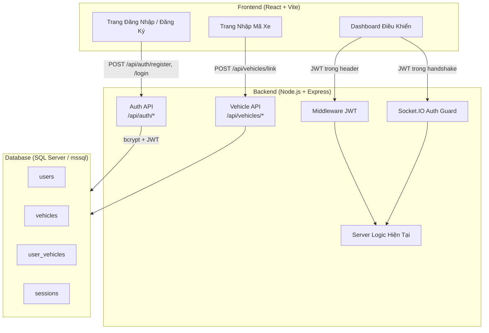
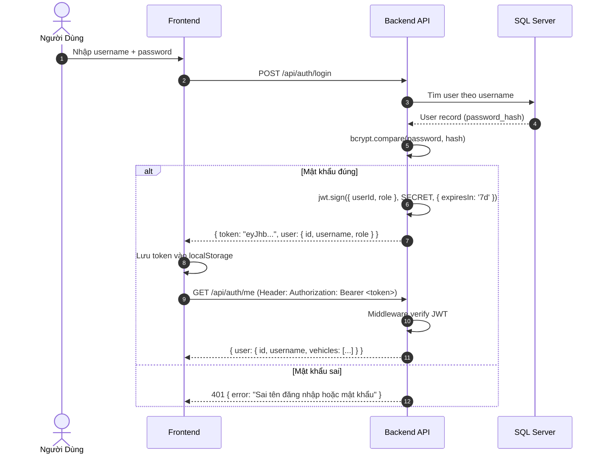
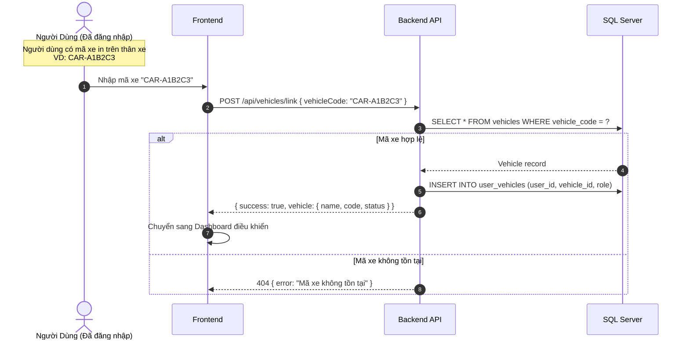
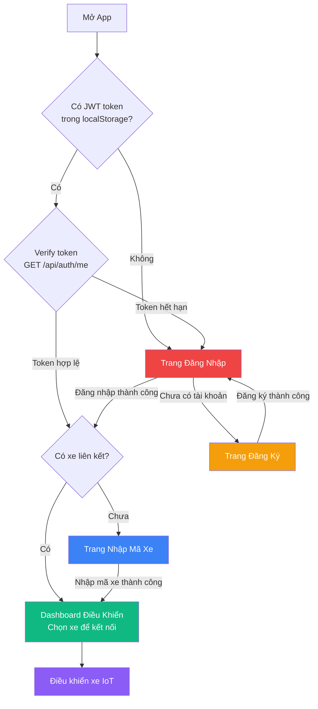

# 🔐 Kế Hoạch Bảo Mật: Hệ Thống Xác Thực & Liên Kết Xe

## Tổng Quan

Triển khai hệ thống **đăng ký / đăng nhập / xác thực người dùng** và cơ chế **nhập mã xe để kết nối xe với tài khoản**, tích hợp database cho dự án IoT Car ESP32.

> [!IMPORTANT]
> Hiện tại server backend ([server.js](file:///d:/CNTT/duan_esp32/backend/server.js)) chạy **không có bất kỳ lớp bảo mật nào** — ai có IP đều có thể điều khiển xe. Kế hoạch này sẽ thêm toàn bộ lớp xác thực.

---

## 📐 Kiến Trúc Hệ Thống Sau Khi Thêm Auth



---

## 📊 Thiết Kế Database

Sử dụng **SQL Server** (via `mssql`) — hệ quản trị CSDL mạnh mẽ, tích hợp sẵn trên Windows, hỗ trợ quản lý bằng SSMS, phù hợp dự án IoT có yêu cầu bảo mật cao.

### Bảng `users`

| Cột | Kiểu | Mô tả |
|-----|------|-------|
| `id` | INT IDENTITY(1,1) PK | ID người dùng |
| `username` | NVARCHAR(100) UNIQUE NOT NULL | Tên đăng nhập |
| `email` | NVARCHAR(255) UNIQUE NOT NULL | Email |
| `password_hash` | NVARCHAR(255) NOT NULL | Mật khẩu đã hash (bcrypt) |
| `display_name` | NVARCHAR(100) | Tên hiển thị |
| `role` | NVARCHAR(20) DEFAULT 'user' | Vai trò: `admin` / `user` |
| `created_at` | DATETIME2 DEFAULT GETDATE() | Ngày tạo |
| `last_login` | DATETIME2 | Lần đăng nhập cuối |

### Bảng `vehicles`

| Cột | Kiểu | Mô tả |
|-----|------|-------|
| `id` | INT IDENTITY(1,1) PK | ID xe |
| `vehicle_code` | NVARCHAR(50) UNIQUE NOT NULL | **Mã xe** (VD: `CAR-A1B2C3`) — dùng để liên kết |
| `name` | NVARCHAR(100) | Tên xe (VD: "Xe IoT #1") |
| `description` | NVARCHAR(500) | Mô tả xe |
| `hardware_id` | NVARCHAR(50) UNIQUE | MAC Address ESP32 (tự đăng ký) |
| `status` | NVARCHAR(20) DEFAULT 'offline' | `online` / `offline` |
| `created_at` | DATETIME2 DEFAULT GETDATE() | Ngày tạo |

### Bảng `user_vehicles` (Quan hệ N-N)

| Cột | Kiểu | Mô tả |
|-----|------|-------|
| `id` | INT IDENTITY(1,1) PK | ID |
| `user_id` | INT FK → users.id | ID người dùng |
| `vehicle_id` | INT FK → vehicles.id | ID xe |
| `role` | NVARCHAR(20) DEFAULT 'driver' | `owner` / `driver` / `viewer` |
| `linked_at` | DATETIME2 DEFAULT GETDATE() | Ngày liên kết |

### Bảng `sessions` (Lịch sử phiên điều khiển)

| Cột | Kiểu | Mô tả |
|-----|------|-------|
| `id` | INT IDENTITY(1,1) PK | ID |
| `user_id` | INT FK → users.id | Ai điều khiển |
| `vehicle_id` | INT FK → vehicles.id | Xe nào |
| `started_at` | DATETIME2 | Bắt đầu phiên |
| `ended_at` | DATETIME2 | Kết thúc phiên |
| `ip_address` | NVARCHAR(45) | IP kết nối |

---

## 🔧 Chi Tiết Triển Khai Từng Giai Đoạn

### Giai Đoạn 1: Database + Auth API (Backend)

#### 1.1 Cài đặt dependencies mới

```bash
cd backend
npm install mssql bcrypt jsonwebtoken
```

#### 1.2 Cấu trúc file mới trong backend

```
backend/
├── database/
│   ├── db.js              # Khởi tạo SQL Server connection pool
│   ├── schema.sql          # SQL tạo bảng
│   └── seed.js             # Dữ liệu mẫu (admin + xe test)
├── middleware/
│   └── auth.js             # JWT verify middleware
├── controllers/
│   ├── authController.js   # Đăng ký, đăng nhập, đổi mật khẩu
│   ├── vehicleController.js # CRUD xe, liên kết mã xe
│   └── ttsController.js    # (Đã có)
├── routes/
│   ├── authRoutes.js       # /api/auth/*
│   └── vehicleRoutes.js    # /api/vehicles/*
├── services/
│   └── udpDiscovery.js     # (Đã có)
└── server.js               # Tích hợp routes + middleware
```

#### 1.3 API Endpoints

| Method | Endpoint | Mô tả | Auth? |
|--------|----------|-------|-------|
| `POST` | `/api/auth/register` | Đăng ký tài khoản mới | ❌ |
| `POST` | `/api/auth/login` | Đăng nhập, trả JWT | ❌ |
| `GET` | `/api/auth/me` | Lấy thông tin user hiện tại | ✅ JWT |
| `PUT` | `/api/auth/password` | Đổi mật khẩu | ✅ JWT |
| `POST` | `/api/vehicles/link` | **Nhập mã xe** để liên kết với tài khoản | ✅ JWT |
| `GET` | `/api/vehicles/my` | Danh sách xe đã liên kết | ✅ JWT |
| `DELETE` | `/api/vehicles/unlink/:id` | Hủy liên kết xe | ✅ JWT |
| `POST` | `/api/vehicles/create` | Tạo xe mới (Admin) | ✅ JWT + Admin |

#### 1.4 Luồng Xác Thực JWT



#### 1.5 Luồng Liên Kết Xe Bằng Mã Xe



---

### Giai Đoạn 2: Socket.IO Auth Guard (Bảo vệ WebSocket)

Thay đổi quan trọng nhất: **mọi kết nối WebSocket phải gửi JWT token** khi handshake.

```javascript
// middleware/socketAuth.js
io.use((socket, next) => {
  const token = socket.handshake.auth?.token;
  if (!token) return next(new Error('Chưa xác thực'));
  
  try {
    const decoded = jwt.verify(token, process.env.JWT_SECRET);
    socket.userId = decoded.userId;
    socket.userRole = decoded.role;
    next();
  } catch (err) {
    next(new Error('Token không hợp lệ'));
  }
});
```

Khi frontend kết nối:
```javascript
// Frontend: thêm token vào socket connection
const socket = io(BACKEND_URL, {
  query: { role: 'frontend' },
  auth: { token: localStorage.getItem('jwt_token') }
});
```

---

### Giai Đoạn 3: Frontend — Trang Đăng Nhập / Đăng Ký / Liên Kết Xe

#### 3.1 File mới trong frontend

```
frontend/src/
├── pages/
│   ├── LoginPage.tsx        # Form đăng nhập
│   ├── RegisterPage.tsx     # Form đăng ký
│   └── VehicleLinkPage.tsx  # Nhập mã xe để kết nối
├── contexts/
│   └── AuthContext.tsx      # React Context quản lý auth state
├── services/
│   └── authService.ts       # API calls (login, register, linkVehicle)
├── components/
│   └── ProtectedRoute.tsx   # Chặn truy cập nếu chưa login
└── App.tsx                  # Thêm routing logic
```

#### 3.2 Luồng UI Người Dùng



---

### Giai Đoạn 4: ESP32 Tự Đăng Ký Xe

ESP32 khi khởi động sẽ gửi **MAC Address** lên server để tự đăng ký/cập nhật trạng thái:

```
ESP32 Boot → Kết nối WiFi → Gửi lên server:
{
  "hardware_id": "AA:BB:CC:DD:EE:FF",
  "vehicle_code": "CAR-A1B2C3"  // Hardcode hoặc đọc từ EEPROM
}
```

Server sẽ:
1. Tìm xe theo `hardware_id` hoặc `vehicle_code`
2. Nếu chưa có → tạo mới trong DB
3. Cập nhật `status = 'online'`
4. Khi disconnect → cập nhật `status = 'offline'`

---

## 🗓️ Timeline Triển Khai

| Giai Đoạn | Công Việc | Thời Gian Ước Tính |
|-----------|-----------|-------------------|
| **GĐ 1** | Database schema + Auth API (register/login/JWT) | ~2-3 giờ |
| **GĐ 2** | Socket.IO Auth Guard + Vehicle API | ~1-2 giờ |
| **GĐ 3** | Frontend: Login/Register/VehicleLink pages + AuthContext | ~3-4 giờ |
| **GĐ 4** | ESP32 firmware: gửi hardware_id khi kết nối | ~1 giờ |
| **GĐ 5** | Testing & polish toàn bộ luồng | ~1-2 giờ |
| | **Tổng cộng** | **~8-12 giờ** |

---

## 🔒 Các Biện Pháp Bảo Mật

| Biện pháp | Chi tiết |
|-----------|----------|
| **Mã hóa mật khẩu** | `bcrypt` với salt rounds = 12 |
| **JWT Token** | Ký bằng secret key, hết hạn 7 ngày |
| **Rate Limiting** | Giới hạn 5 lần login sai / 15 phút / IP |
| **Input Validation** | Validate username (3-30 ký tự), email format, password (≥6 ký tự) |
| **SQL Injection** | `mssql` sử dụng parameterized queries (`request.input()`) mặc định |
| **CORS** | Chỉ cho phép origin từ frontend domain |
| **Socket Auth** | Mọi WebSocket connection phải có JWT hợp lệ |
| **Phân quyền xe** | Chỉ user đã liên kết mã xe mới được điều khiển xe đó |

---

## 📁 Biến Môi Trường Cần Thêm (.env)

```env
# Auth
JWT_SECRET=your-super-secret-key-change-this-in-production
JWT_EXPIRES_IN=7d
BCRYPT_SALT_ROUNDS=12

# Database (SQL Server)
DB_HOST=localhost
DB_PORT=1433
DB_USER=sa
DB_PASSWORD=123
DB_NAME=iotcar_db
```

---

## ✅ Checklist Triển Khai

- [x] **GĐ 1.1** — Cài `mssql`, `bcrypt`, `jsonwebtoken`
- [x] **GĐ 1.2** — Tạo `database/db.js` (connection pool) + `schema.sql`
- [x] **GĐ 1.3** — Tạo `database/seed.js` (admin mặc định + 1 xe test)
- [x] **GĐ 1.4** — Tạo `middleware/auth.js` (JWT middleware)
- [x] **GĐ 1.5** — Tạo `controllers/authController.js`
- [x] **GĐ 1.6** — Tạo `controllers/vehicleController.js`
- [x] **GĐ 1.7** — Tạo routes + tích hợp vào `server.js`
- [x] **GĐ 2.1** — Thêm Socket.IO auth middleware
- [x] **GĐ 2.2** — Kiểm tra quyền xe khi nhận `drive_command`
- [x] **GĐ 3.1** — Tạo `AuthContext.tsx` + `authService.ts`
- [x] **GĐ 3.2** — Tạo `LoginPage.tsx` + `RegisterPage.tsx`
- [x] **GĐ 3.3** — Tạo `VehicleLinkPage.tsx`
- [x] **GĐ 3.4** — Cập nhật `App.tsx` với routing logic
- [x] **GĐ 3.5** — Cập nhật `useCarWebSocket` gửi JWT token
- [x] **GĐ 4.1** — Cập nhật firmware ESP32 gửi `hardware_id` (MAC) & mã xe `CAR_IOT`
- [ ] **GĐ 5.1** — Test toàn bộ luồng đăng ký → đăng nhập → liên kết xe → điều khiển
