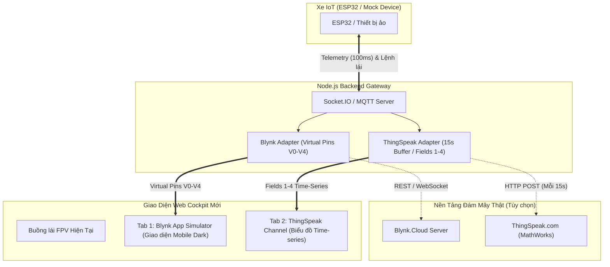

# 📋 KẾ HOẠCH MÔ PHỎNG & TÍCH HỢP BLYNK VÀ THINGSPEAK

> **Đề bài & Mục tiêu:** Bổ sung khả năng mô phỏng và kết nối với hai nền tảng IoT kinh điển là **Blynk IoT** (Điều khiển thời gian thực qua Widgets / Virtual Pins) và **ThingSpeak** (Ghi nhật ký, vẽ đồ thị chuỗi thời gian & phân tích dữ liệu qua Channels / Fields).

---

## 🎯 1. Phân Định Vai Trò: Blynk vs. ThingSpeak

Trong hệ sinh thái IoT, hai nền tảng này đóng hai vai trò hoàn toàn bổ trợ nhau:

| Tiêu chí | Blynk IoT | ThingSpeak (MathWorks) |
| :--- | :--- | :--- |
| **Mục đích chính** | **Điều khiển & Tương tác 2 chiều tức thời** | **Lưu trữ dữ liệu lịch sử & Phân tích đồ thị** |
| **Giao thức cốt lõi** | WebSocket / TCP / MQTT (Độ trễ thấp < 100ms) | HTTP REST API / MQTT (Rate limit: 15s/lần) |
| **Khái niệm dữ liệu** | **Virtual Pins (V0, V1, V2,...)** | **Channels & Fields (Field 1, 2, 3,...)** |
| **Giao diện đặc trưng** | Widget di động (Joystick, Button, Slider, Gauge) | Đồ thị thời gian thực (Time-series Line Charts) |
| **Ứng dụng trên xe** | Người lái cầm điện thoại gạt cần lái xe | Xem biểu đồ tụt pin, đồ thị khoảng cách vật cản |

---

## 📐 2. Kiến Trúc Tích Hợp Đa Nền Tảng (Hybrid Architecture)

Hệ thống hỗ trợ cả **2 chế độ**:
1. **Cloud Thật (Real Cloud):** Đẩy dữ liệu trực tiếp lên máy chủ `blynk.cloud` và `thingspeak.com`.
2. **Mô Phỏng Cục Bộ (Local Emulator - Khuyên dùng khi báo cáo):** Chạy ngay trong mạng nội bộ, giao diện Web mô phỏng y hệt ứng dụng Blynk và trang Channel ThingSpeak (không sợ mất mạng Internet, không lo hết hạn ngạch API).

---

## 🎮 3. Thiết Kế Mô Phỏng Blynk IoT

### 3.1. Bản đồ chân ảo (Virtual Pin Mapping)

| Virtual Pin | Kiểu Widget Blynk | Hướng dữ liệu | Mô tả chức năng |
| :---: | :---: | :---: | :--- |
| **`V0`** | **Joystick 2D** | Gửi xuống xe (Write) | Điều khiển tiến / lùi / rẽ trái / rẽ phải $(X, Y)$ |
| **`V1`** | **Slider (0 – 100)** | Gửi xuống xe (Write) | Giới hạn tốc độ xe (% Ga) |
| **`V2`** | **Gauge (0 – 100%)** | Nhận từ xe (Read) | Kim đồng hồ hiển thị % dung lượng Pin |
| **`V3`** | **Value Display** | Nhận từ xe (Read) | Màn hình số hiển thị khoảng cách vật cản (cm) |
| **`V4`** | **Button / Switch** | Gửi xuống xe (Write) | Nút bấm Phanh khẩn cấp / Còi báo động |
| **`V5`** | **LED Widget** | Nhận từ xe (Read) | Đèn LED xanh báo xe đang Online hay Offline |

### 3.2. Giao diện mô phỏng (`BlynkSimulatorView.tsx`)
* Thiết kế mô phỏng **màn hình điện thoại Smartphone** đặt ngay trên Web Cockpit.
* Sử dụng tông màu tối đặc trưng của Blynk (`#1E1E24`) với màu nhấn xanh ngọc (`#24C789`).
* Kéo cần Joystick trên màn hình điện thoại ảo $\rightarrow$ Bắn sự kiện `blynk:write:V0` $\rightarrow$ Xe thật/xe ảo di chuyển tức thì!

---

## 📈 4. Thiết Kế Mô Phỏng ThingSpeak

### 4.1. Cấu trúc Kênh (Channel Data Schema)

* **Channel Name:** `IoT Car Telemetry & Analytics`
* **Update Interval:** **15 giây / lần** (Mô phỏng chính xác cơ chế giới hạn tần suất của ThingSpeak Free Tier để tiết kiệm tài nguyên).

| Trường (Field) | Tên dữ liệu | Đơn vị | Mục đích phân tích |
| :---: | :--- | :---: | :--- |
| **`Field 1`** | **Dung lượng Pin** | `%` | Vẽ đường cong xả pin theo thời gian (Battery Drain Curve) |
| **`Field 2`** | **Khoảng cách vật cản** | `cm` | Thống kê số lần xe gặp chướng ngại vật |
| **`Field 3`** | **Tốc độ xe** | `PWM` (0 - 255) | Đo lường mức độ vận hành động cơ |
| **`Field 4`** | **Độ trễ truyền dẫn (Ping)** | `ms` | Đánh giá chất lượng mạng không dây WiFi |

### 4.2. Giao diện mô phỏng (`ThingSpeakSimulatorView.tsx`)
* Thiết kế chuẩn theo giao diện website **ThingSpeak Channel View**:
  * Hiển thị Channel ID, Author, Ngày tạo, Trạng thái Access (Public).
  * Hiển thị bảng **Channel API Keys** (Write API Key, Read API Key).
* **4 Khung biểu đồ đường thời gian thực (Line Charts):**
  * Tự động thêm điểm mới sau mỗi 15 giây.
  * Hỗ trợ phóng to, thu nhỏ, rê chuột xem tọa độ thời gian (Timestamp) và giá trị.
* **Nút bấm hữu ích:** `Export Data to CSV` (Tải toàn bộ lịch sử đo lường về máy tính làm báo cáo Excel).

---

## 🛠️ 5. Kế Hoạch Triển Khai (Sprint Roadmap)

### 🔹 Sprint 1: Xây dựng Bộ chuyển đổi Backend (Bridge Services)
* **Tạo file `backend/services/blynkService.js`:**
  * Quản lý trạng thái các Virtual Pins $V_0 \rightarrow V_5$.
  * Cung cấp REST endpoint giả lập Blynk HTTP API: `GET /api/blynk/update?v0=x,y` và `GET /api/blynk/get?pin=v2`.
* **Tạo file `backend/services/thingspeakService.js`:**
  * Bộ đệm dữ liệu (Ring Buffer) 15 giây: Gom mẫu trung bình và lưu trữ lịch sử 100 điểm đo gần nhất.
  * Endpoint tương thích ThingSpeak: `POST /update?api_key=...&field1=...&field2=...`
  * Endpoint lấy lịch sử: `GET /channels/:id/feeds.json`.

### 🔹 Sprint 2: Frontend - Màn hình giả lập Blynk Smartphone
* **Tạo component `BlynkSimulatorView.tsx`:**
  * Khung viền điện thoại iPhone/Android.
  * Các widget: Joystick, Slider tốc độ, Gauge pin, Display khoảng cách, Switch còi.
  * Đồng bộ 2 chiều với xe qua Socket.io.

### 🔹 Sprint 3: Frontend - Màn hình Dashboard ThingSpeak Channel
* **Tạo component `ThingSpeakSimulatorView.tsx`:**
  * Sử dụng thư viện biểu đồ nhẹ.
  * Vẽ 4 đồ thị tương ứng 4 Fields.
  * Nút tải file CSV để nộp kèm báo cáo môn học.

### 🔹 Sprint 4 (Tùy chọn): Kết nối Cloud Thật
* Bổ sung API Key của Blynk.Cloud và ThingSpeak vào file `.env`.
* Khi bật cờ `ENABLE_REAL_CLOUD=true`, backend sẽ tự động đẩy bản sao dữ liệu lên Internet thật.

---

## 🏆 6. Kịch Bản Trình Bày Demo Đồ Án (Cách Ăn Điểm Tuyệt Đối)

Khi thầy cô yêu cầu kiểm tra nội dung này, bạn có thể thực hiện theo quy trình 3 bước:

1. **Bước 1 (Giới thiệu Kiến trúc):**
   * *"Dự án của em được thiết kế theo mô hình mở, hỗ trợ tích hợp với cả 2 nền tảng IoT phổ biến là Blynk và ThingSpeak."*
2. **Bước 2 (Demo Điều khiển qua Blynk):**
   * Mở giao diện **Blynk Mobile View**, gạt cần Joystick ảo $\rightarrow$ Chỉ ra xe quay bánh tương ứng $\rightarrow$ Giải thích cơ chế ánh xạ **Virtual Pins ($V_0 \rightarrow V_4$)**.
3. **Bước 3 (Demo Phân tích dữ liệu qua ThingSpeak):**
   * Mở giao diện **ThingSpeak Channel**, cho xe chạy để cảm biến siêu âm đổi khoảng cách $\rightarrow$ Chỉ cho thầy cô thấy sau mỗi 15 giây, điểm dữ liệu mới nhảy lên biểu đồ $\rightarrow$ Bấm nút **Export CSV** để xuất dữ liệu mẫu.
