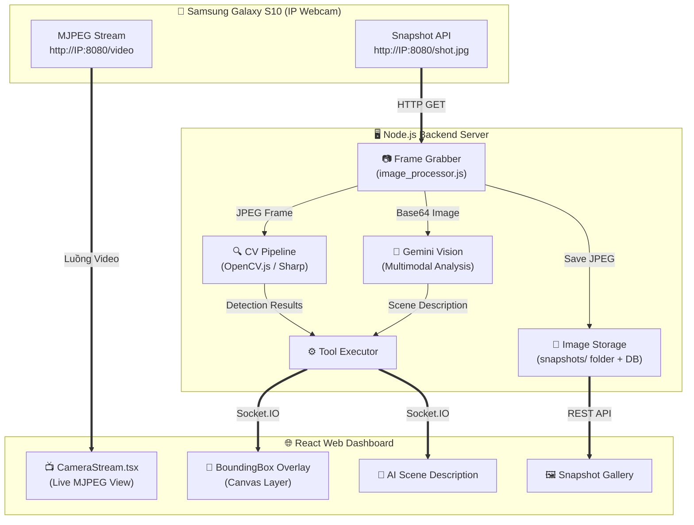
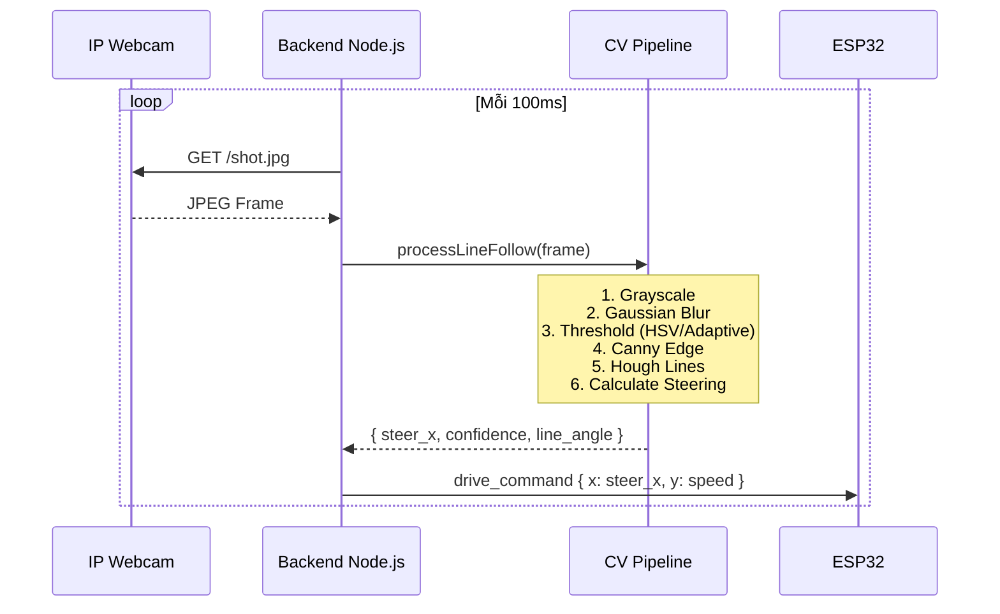
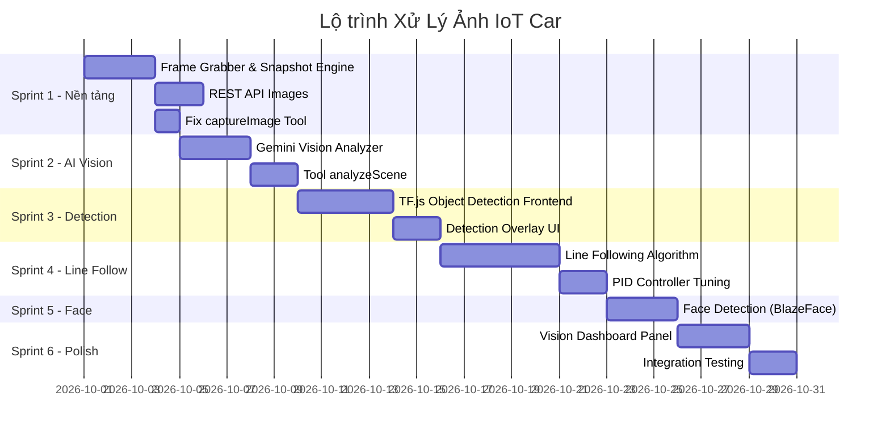

 # KẾ HOẠCH TRIỂN KHAI HỆ THỐNG XỬ LÝ ẢNH CHO XE IOT ESP32

> [!NOTE]
> Tài liệu phân tích kiến trúc hiện tại và đề xuất kế hoạch chi tiết tích hợp **Xử lý Ảnh (Computer Vision)** vào hệ thống xe IoT ESP32 với camera Samsung Galaxy S10 5G (IP Webcam MJPEG).

---

## 1. PHÂN TÍCH HIỆN TRẠNG

### Những gì đã có ✅
| Thành phần | Trạng thái | Ghi chú |
|---|---|---|
| Camera MJPEG Stream (IP Webcam) | ✅ Hoạt động | Samsung Galaxy S10 → `http://IP:8080/video` |
| Frontend `CameraStream.tsx` | ✅ Hoạt động | Hiển thị MJPEG, xoay ảnh, audio stream |
| Gemini Vision (Multimodal) | ✅ Cơ bản | [gemini_llm.js](file:///d:/CNTT/duan_esp32/backend/ai/gemini_llm.js) đã hỗ trợ `base64Image` input |
| Tool `captureImage` | ✅ Đã khai báo | [tool_registry.js](file:///d:/CNTT/duan_esp32/backend/ai/tool_registry.js#L109-L118) — chỉ emit event, chưa thực sự capture |
| Voice Command gửi kèm ảnh FPV | ✅ Cơ bản | [server.js](file:///d:/CNTT/duan_esp32/backend/server.js#L247-L264) — nhận `base64Image` từ frontend |

### Những gì thiếu ❌
| Chức năng | Trạng thái | Mức ưu tiên |
|---|---|---|
| Capture thực sự từ MJPEG stream trên Backend | ❌ Chưa có | 🔴 Rất cao |
| Object Detection (YOLO / TF.js) | ❌ Chưa có | 🟡 Cao |
| Line Following (Dò đường) | ❌ Chưa có | 🟡 Cao |
| Face Detection / Recognition | ❌ Chưa có | 🟠 Trung bình |
| Gemini Vision mô tả cảnh đường | ❌ Chưa có pipeline tự động | 🟡 Cao |
| Lưu ảnh snapshot lên server / DB | ❌ Chưa có | 🟡 Cao |
| Frontend hiển thị kết quả phát hiện (Bounding Boxes) | ❌ Chưa có | 🟠 Trung bình |

---

## 2. KIẾN TRÚC XỬ LÝ ẢNH ĐỀ XUẤT



---

## 3. CÁC SPRINT TRIỂN KHAI

### Sprint 1: Frame Grabber & Snapshot Engine 🔴
> **Mục tiêu**: Backend có thể chụp ảnh thực sự từ camera IP Webcam và lưu trữ

#### Files mới cần tạo:

##### [NEW] `backend/services/imageProcessor.js`
```
Chức năng:
- grabFrame(cameraIp, cameraPort): GET http://{ip}:{port}/shot.jpg → Buffer JPEG
- bufferToBase64(buffer): Chuyển đổi Buffer → base64 string cho Gemini
- saveSnapshot(buffer, label): Lưu file JPEG vào thư mục snapshots/ với timestamp
- getSnapshotList(): Liệt kê danh sách ảnh đã chụp
- deleteSnapshot(filename): Xóa ảnh
```

##### [NEW] `backend/snapshots/` (Thư mục lưu ảnh)
```
Cấu trúc: snapshots/2026-09-30_064500_snapshot.jpg
Tối đa: 100 ảnh gần nhất (auto cleanup)
```

##### [NEW] `backend/routes/imageRoutes.js`
```
REST API Endpoints:
- GET  /api/images/capture      → Chụp 1 frame và trả về base64 + lưu file
- GET  /api/images/list          → Danh sách ảnh đã chụp (tên, kích thước, timestamp)
- GET  /api/images/:filename     → Serve ảnh tĩnh
- DELETE /api/images/:filename   → Xóa ảnh
```

##### [MODIFY] `backend/ai/tool_registry.js` — Tool `captureImage`
```diff
 case 'captureImage': {
-  const { deviceSocket, ioSocket } = context;
-  if (deviceSocket) deviceSocket.emit('capture_image', { label: params.label || 'snapshot' });
-  if (ioSocket) ioSocket.emit('capture_image', { label: params.label || 'snapshot' });
-  return {
-    success: true,
-    action: 'captureImage',
-    label: params.label || 'snapshot',
-    message: 'Đã gửi lệnh chụp ảnh FPV Camera.',
-  };
+  // Capture thực sự từ IP Webcam
+  const { grabFrame, saveSnapshot, bufferToBase64 } = await import('../services/imageProcessor.js');
+  const cameraIp = context.cameraConfig?.ip || '192.168.1.15';
+  const cameraPort = context.cameraConfig?.port || '8080';
+  
+  const frameBuffer = await grabFrame(cameraIp, cameraPort);
+  const filename = await saveSnapshot(frameBuffer, params.label || 'snapshot');
+  const base64 = bufferToBase64(frameBuffer);
+  
+  // Broadcast ảnh snapshot tới tất cả frontend
+  if (ioSocket) ioSocket.emit('snapshot_captured', { filename, base64, label: params.label });
+  
+  return {
+    success: true,
+    action: 'captureImage',
+    filename,
+    base64Preview: base64.substring(0, 100) + '...',
+    message: `Đã chụp và lưu ảnh: ${filename}`,
+  };
 }
```

##### Dependencies mới:
```json
{
  "sharp": "^0.33.x",       // Resize, crop, convert ảnh tốc độ cao
  "axios": "^1.7.x"         // HTTP client để GET ảnh từ IP Webcam
}
```

---

### Sprint 2: Gemini Vision — Phân Tích Cảnh FPV Thông Minh 🟡
> **Mục tiêu**: AI Agent Linh có thể "nhìn" qua camera và mô tả cảnh vật

#### Files cần sửa/tạo:

##### [NEW] `backend/ai/vision_analyzer.js`
```
Chức năng:
- analyzeScene(base64Image): Gọi Gemini Vision mô tả cảnh đường/phòng
- detectObstacles(base64Image): Phát hiện chướng ngại vật qua AI 
- describeEnvironment(base64Image): Mô tả chi tiết môi trường xung quanh
- analyzeForNavigation(base64Image): Phân tích hướng đi khả thi
```

##### [NEW] Tool mới: `analyzeScene`
```js
{
  name: 'analyzeScene',
  description: 'Quan sát và mô tả cảnh vật phía trước qua camera FPV',
  parameters: {
    type: 'object',
    properties: {
      question: { 
        type: 'string', 
        description: 'Câu hỏi cụ thể về cảnh vật (tùy chọn)' 
      },
    },
  },
}
```

> **Luồng hoạt động khi Bố AN hỏi "Phía trước có gì?":**
> 1. AI Agent nhận câu lệnh → gọi tool `analyzeScene`
> 2. Backend tự capture 1 frame từ IP Webcam → chuyển base64
> 3. Gọi Gemini Vision API với prompt tiếng Việt + ảnh
> 4. Gemini trả về mô tả cảnh ("Dạ Bố, phía trước con thấy có 1 cái bàn gỗ, bên trái là tường trắng...")
> 5. AI Agent trả kết quả về frontend + đọc TTS

##### [MODIFY] `backend/ai/gemini_llm.js`
```
Bổ sung function chuyên dùng cho Vision:
- callGeminiVision(base64Image, prompt): Gọi Gemini chỉ với ảnh + câu hỏi 
  (tách riêng khỏi callGeminiAgent để tối ưu token/latency)
```

---

### Sprint 3: Object Detection Thời Gian Thực (TensorFlow.js) 🟡
> **Mục tiêu**: Phát hiện vật thể (người, xe, vật cản) trên luồng camera

#### Phương án triển khai — 2 lựa chọn:

##### Phương án A: Object Detection trên Backend (Node.js)
```
Ưu điểm: Mạnh hơn, GPU server, không tốn tài nguyên trình duyệt
Nhược điểm: Tốn băng thông truyền frame lên server

Tech stack:
- @tensorflow/tfjs-node hoặc @tensorflow/tfjs-node-gpu
- Model: COCO-SSD (80 class vật thể) hoặc MobileNet-SSD
- Pipeline: Grab frame mỗi 500ms → Detect → Emit kết quả qua Socket.IO
```

##### Phương án B: Object Detection trên Frontend (Browser) ⭐ Khuyến nghị
```
Ưu điểm: Không tốn server, xử lý trực tiếp MJPEG frame trên trình duyệt
Nhược điểm: Phụ thuộc phần cứng client (cần GPU/WebGL)

Tech stack:
- @tensorflow/tfjs + @tensorflow-models/coco-ssd
- Xử lý trực tiếp từ  element MJPEG stream
- Vẽ Bounding Box lên Canvas overlay
```

#### Files cần tạo (Phương án B — Frontend):

##### [NEW] `frontend/src/hooks/useObjectDetection.ts`
```typescript
// Custom hook quản lý TF.js model lifecycle
// - Tải model COCO-SSD khi mount
// - Chạy detection loop mỗi 500ms trên ảnh MJPEG
// - Trả về: detections[], isModelLoaded, fps, toggleDetection()
```

##### [NEW] `frontend/src/components/DetectionOverlay.tsx`
```typescript
// Canvas overlay vẽ trên CameraStream
// - Nhận detections[] → vẽ bounding boxes + labels
// - Màu sắc theo class (người=xanh, xe=đỏ, vật thể=vàng)
// - Hiển thị confidence score %
// - Animation smooth khi box di chuyển
```

##### [MODIFY] `frontend/src/components/CameraStream.tsx`
```
Bổ sung:
- Tham chiếu ref tới  element MJPEG
- Tích hợp <DetectionOverlay> canvas layer phủ lên video
- Nút toggle "🔍 Object Detection ON/OFF"
- Hiển thị FPS detection
```

---

### Sprint 4: Line Following — Xe Tự Dò Đường 🟡
> **Mục tiêu**: Xe tự lái theo vạch kẻ đường (line following algorithm)

#### Kiến trúc xử lý:



##### [NEW] `backend/services/lineFollower.js`
```
Pipeline xử lý ảnh (Sharp + thuật toán):
1. Crop ROI (Region of Interest): Cắt 1/3 dưới ảnh (mặt đường)
2. Grayscale → Adaptive Threshold (tách vạch trắng/đen)
3. Tìm contour vạch kẻ → tính centroid
4. So sánh centroid vs tâm ảnh → tính steering offset
5. PID Controller: Chuyển offset → giá trị lái x (-1.0 đến 1.0)
6. Emit drive_command tự động

Tham số cấu hình:
- LINE_COLOR: 'white' | 'black' | 'auto'
- THRESHOLD_VALUE: 128
- PID_KP: 0.5, PID_KI: 0.01, PID_KD: 0.1
- FRAME_INTERVAL_MS: 100
- BASE_SPEED: 40 (tốc độ nền khi dò line)
```

##### [NEW] Tool mới: `followLine`
```js
{
  name: 'followLine',
  description: 'Bật chế độ xe tự dò đường theo vạch kẻ trên sàn',
  parameters: {
    type: 'object',
    properties: {
      speed: { type: 'number', min: 10, max: 60, description: 'Tốc độ dò line' },
      line_color: { type: 'string', enum: ['white', 'black', 'auto'] },
      timeout_s: { type: 'number', description: 'Thời gian chạy tối đa (giây)' },
    },
  },
}
```

---

### Sprint 5: Face Detection & Nhận Diện Người 🟠
> **Mục tiêu**: Phát hiện khuôn mặt, theo dõi người, nhận diện chủ nhân

#### Phương án triển khai:

##### [NEW] `frontend/src/hooks/useFaceDetection.ts`
```
Tech: TensorFlow.js + BlazeFace model (siêu nhẹ, ~2KB)
- Phát hiện khuôn mặt realtime trên browser
- Đánh dấu vị trí mắt, mũi, miệng (landmarks)
- Đếm số người trong khung hình
- Tích hợp với Follow Mode: xe tự xoay theo hướng có người
```

##### [NEW] `backend/services/faceRecognition.js`
```
Sử dụng Gemini Vision cho nhận diện (không cần train model):
- Capture frame → gửi Gemini với prompt: "Mô tả khuôn mặt người trong ảnh"
- Lưu embedding đặc trưng khuôn mặt (nếu cần)
- Cảnh báo: "Phát hiện người lạ trong nhà!" qua TTS
```

---

### Sprint 6: Dashboard Xử Lý Ảnh Trên Frontend 🟠
> **Mục tiêu**: UI hiển thị đẹp mắt cho tất cả tính năng xử lý ảnh

#### Files cần tạo:

##### [NEW] `frontend/src/components/VisionPanel.tsx`
```
Panel tổng hợp Vision trên Desktop Dashboard:
- Tab 1: 📷 Snapshot Gallery (grid ảnh đã chụp, click xem phóng to)
- Tab 2: 🔍 Object Detection (toggle ON/OFF, bảng danh sách vật phát hiện)
- Tab 3: 🛣️ Line Following (trạng thái dò line, visualize steering, PID params)
- Tab 4: 👤 Face Detection (số người phát hiện, landmarks overlay)
- Tab 5: 🧠 AI Scene Analysis (mô tả cảnh từ Gemini, lịch sử phân tích)
```

##### [MODIFY] `frontend/src/views/DesktopDashboardView.tsx`
```
Thêm VisionPanel vào layout Dashboard chính
```

##### [MODIFY] `frontend/src/views/FPVCockpitView.tsx`
```
- Thêm DetectionOverlay canvas trên video FPV
- Thêm nút quick-action: 📷 Chụp ảnh, 🔍 Bật Detection, 🛣️ Bật Line Follow
```

---

## 4. DEPENDENCIES MỚI CẦN CÀI ĐẶT

### Backend (`backend/package.json`):
```json
{
  "sharp": "^0.33.5",
  "axios": "^1.7.9"
}
```

### Frontend (`frontend/package.json`):
```json
{
  "@tensorflow/tfjs": "^4.22.0",
  "@tensorflow-models/coco-ssd": "^2.2.3",
  "@tensorflow-models/blazeface": "^0.1.0"
}
```

---

## 5. THỨ TỰ ƯU TIÊN TRIỂN KHAI



---

## 6. LƯU Ý KỸ THUẬT QUAN TRỌNG

> [!IMPORTANT]
> **Camera IP Webcam (Samsung Galaxy S10)** cung cấp 2 endpoint chính:
> - **MJPEG Stream**: `http://IP:8080/video` — luồng video liên tục (Frontend hiển thị)
> - **Single Snapshot**: `http://IP:8080/shot.jpg` — chụp 1 frame JPEG (Backend dùng cho CV)
> 
> Luôn sử dụng endpoint `shot.jpg` cho xử lý ảnh trên Backend để không can thiệp vào luồng MJPEG.

> [!WARNING]
> **Hiệu năng**: Object Detection trên Frontend (TF.js WebGL) yêu cầu GPU. Trên thiết bị yếu, nên giảm tần suất detection xuống 1-2 FPS thay vì 5 FPS.

> [!TIP]
> **Gemini Vision API** hiện hỗ trợ xử lý ảnh rất tốt và miễn phí (Flash tier). Nên ưu tiên dùng Gemini cho các tác vụ phân tích phức tạp (mô tả cảnh, nhận diện biển báo, đọc chữ) thay vì train model riêng.

---

## 7. CÂU HỎI CẦN XÁC NHẬN

1. **Ưu tiên Sprint nào trước?** Sprint 1+2 (Snapshot + Gemini Vision) hay Sprint 3 (Object Detection)?
2. **Line Following**: Xe có sẵn đường kẻ để test không? Vạch màu gì (trắng/đen)?
3. **Face Detection**: Có cần lưu khuôn mặt chủ nhân để nhận diện "người lạ" không?
4. **Lưu trữ ảnh**: Chỉ lưu cục bộ (folder) hay cần lưu vào SQL Server DB (blob)?
