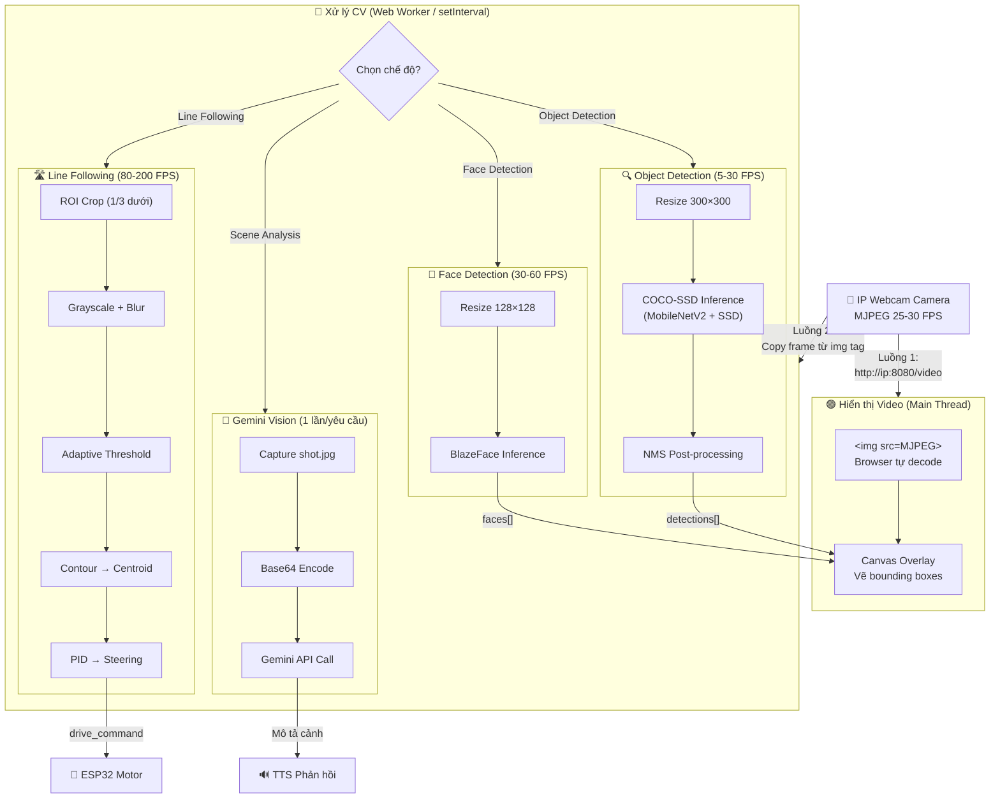

# PHÂN TÍCH THUẬT TOÁN XỬ LÝ ẢNH & ẢNH HƯỞNG ĐẾN FRAME RATE REALTIME

> [!IMPORTANT]
> **Kết luận ngắn gọn**: Xử lý ảnh **KHÔNG** làm giật luồng video MJPEG hiển thị. Kiến trúc **Dual Pipeline** tách riêng hoàn toàn luồng hiển thị video (vẫn 25-30 FPS mượt) và luồng phân tích CV (chạy song song ở tốc độ thấp hơn 2-10 FPS).

---

## 1. KIẾN TRÚC DUAL PIPELINE — TẠI SAO KHÔNG BỊ GIẬT

```mermaid
graph LR
    subgraph Camera ["📱 IP Webcam"]
        MJPEG["MJPEG Stream<br/>25-30 FPS"]
        Shot["shot.jpg<br/>Chụp từng frame"]
    end

    subgraph Pipeline1 ["🟢 PIPELINE 1: Hiển thị Video (Không bị ảnh hưởng)"]
        IMG["&lt;img&gt; tag MJPEG<br/>Trình duyệt decode native"]
        Display["Màn hình người dùng<br/>25-30 FPS mượt mà"]
        IMG --> Display
    end

    subgraph Pipeline2 ["🔵 PIPELINE 2: Xử lý CV (Chạy song song)"]
        Grab["Grab frame<br/>từ &lt;img&gt; → Canvas"]
        Algo["Thuật toán CV<br/>2-10 FPS"]
        Result["Kết quả:<br/>Bounding Boxes,<br/>Steering, Labels"]
        Grab --> Algo --> Result
    end

    MJPEG ==> IMG
    Shot -.->|"Backend capture<br/>(khi cần)"| Grab
    IMG -.->|"drawImage()<br/>copy frame"| Grab
    Result -.->|"Vẽ overlay<br/>lên Canvas"| Display

    style Pipeline1 fill:#065f46,stroke:#10b981,stroke-width:2px
    style Pipeline2 fill:#1e3a5f,stroke:#3b82f6,stroke-width:2px
```



### Giải thích cơ chế:

| | Pipeline 1 (Video) | Pipeline 2 (CV) |
|---|---|---|
| **Mục đích** | Hiển thị video cho người xem | Phân tích, phát hiện vật thể |
| **Tốc độ** | 25-30 FPS (native browser) | 2-10 FPS (tùy thuật toán) |
| **Blocking?** | ❌ Không bao giờ bị chặn | ❌ Chạy trong Web Worker / requestAnimationFrame riêng |
| **Ảnh hưởng lẫn nhau?** | **KHÔNG** — `` tag MJPEG được trình duyệt decode bằng luồng riêng | Chỉ "mượn" 1 frame từ `` để phân tích, không can thiệp luồng gốc |

> Ví dụ tương tự: Giống như bạn đang xem TV (Pipeline 1), và cứ 5 giây chụp 1 ảnh màn hình TV để phân tích (Pipeline 2). Việc chụp ảnh không làm TV bị giật.

---

## 2. DANH SÁCH THUẬT TOÁN CHI TIẾT

### 2.1 Thuật toán Xử lý Ảnh Cơ bản (Classical CV)

#### ① Grayscale Conversion (Chuyển ảnh xám)
```
Input:  Ảnh RGB (3 kênh màu, ví dụ 640×480×3)
Output: Ảnh Grayscale (1 kênh, 640×480×1)
Công thức: Gray = 0.299×R + 0.587×G + 0.114×B

Dùng cho: Line Following, Edge Detection
Tốc độ: < 1ms/frame (cực nhanh, chỉ phép nhân đơn giản)
```

#### ② Gaussian Blur (Làm mờ Gauss — Khử nhiễu)
```
Input:  Ảnh Grayscale
Output: Ảnh đã khử nhiễu
Kernel: Ma trận 5×5 hoặc 3×3 (giá trị Gaussian)

Dùng cho: Tiền xử lý trước Threshold/Edge (loại bỏ nhiễu hạt)
Tốc độ: ~1-2ms/frame (kernel nhỏ)
Ảnh hưởng FPS: Không đáng kể
```

#### ③ Adaptive Threshold (Ngưỡng thích ứng — Tách đen/trắng)
```
Input:  Ảnh Grayscale đã blur
Output: Ảnh nhị phân (Binary: chỉ có 0 hoặc 255)

Có 2 loại:
- Global Threshold: So 1 ngưỡng cố định (nhanh nhưng dễ lỗi khi ánh sáng thay đổi)
- Adaptive Threshold: Tính ngưỡng cục bộ cho từng vùng (chậm hơn nhưng chính xác)

Dùng cho: Line Following (tách vạch kẻ đường khỏi nền sàn)
Tốc độ: ~1-3ms/frame
```

#### ④ Canny Edge Detection (Phát hiện cạnh)
```
Input:  Ảnh Grayscale đã blur
Output: Ảnh chỉ chứa các cạnh (đường viền vật thể)

Quy trình 4 bước nội bộ:
  1. Tính Gradient (Sobel X, Sobel Y) → Cường độ + Hướng cạnh
  2. Non-Maximum Suppression → Chỉ giữ pixel cạnh mạnh nhất
  3. Double Threshold → Phân loại cạnh mạnh/yếu
  4. Hysteresis → Nối cạnh yếu kề cạnh mạnh

Dùng cho: Line Following (bổ sung), Phát hiện hình dạng
Tốc độ: ~2-5ms/frame
```

#### ⑤ Hough Line Transform (Biến đổi Hough — Tìm đường thẳng)
```
Input:  Ảnh cạnh (output từ Canny)
Output: Danh sách đường thẳng (rho, theta) hoặc (x1,y1,x2,y2)

Nguyên lý: Chuyển mỗi điểm cạnh sang không gian Hough (r,θ),
           tìm các điểm giao nhau nhiều nhất → đường thẳng

Dùng cho: Line Following (phát hiện vạch kẻ đường)
Tốc độ: ~3-8ms/frame (phụ thuộc số cạnh)
```

#### ⑥ Contour Analysis (Phân tích đường viền)
```
Input:  Ảnh nhị phân (từ Threshold)
Output: Danh sách contours (đường bao quanh vật thể)
        + Centroid (tâm), Area (diện tích), BoundingRect

Dùng cho: Line Following (tìm tâm vạch kẻ → tính lệch lái)
Tốc độ: ~1-3ms/frame
```

#### ⑦ ROI Cropping (Cắt vùng quan tâm)
```
Input:  Ảnh gốc 640×480
Output: Ảnh nhỏ hơn, ví dụ 640×160 (chỉ 1/3 dưới = mặt đường)

Dùng cho: Line Following (chỉ xử lý phần đường, bỏ phần trời/tường)
Tốc độ: < 0.5ms (chỉ là cắt mảng)
Lợi ích: Giảm 66% pixel cần xử lý → tăng tốc 3x cho tất cả bước sau
```

#### ⑧ HSV Color Space (Không gian màu HSV)
```
Input:  Ảnh RGB
Output: Ảnh HSV (Hue - Sắc độ, Saturation - Độ bão hòa, Value - Độ sáng)

Dùng cho: Lọc màu chính xác hơn RGB (ví dụ: tách vạch đỏ, vạch xanh)
         Line Following trên vạch màu
Tốc độ: ~1-2ms/frame
```

---

### 2.2 Thuật toán AI / Deep Learning

#### ⑨ COCO-SSD (Object Detection — Phát hiện vật thể)
```
Model:     MobileNetV2 + SSD (Single Shot MultiBox Detector)
Kích thước: ~5MB (tải 1 lần khi mở trang)
Input:     Ảnh 300×300 (auto resize từ 640×480)
Output:    Danh sách { class, score, bbox[x,y,w,h] }
           80 class: person, car, bottle, chair, dog, cat, phone...

Dùng cho: Object Detection realtime
Tốc độ:
  ┌─────────────────────┬──────────┬─────────┐
  │ Nền tảng            │ FPS      │ Latency │
  ├─────────────────────┼──────────┼─────────┤
  │ Browser + WebGL GPU │ 15-30fps │ 33-66ms │
  │ Browser + CPU only  │ 2-5fps   │ 200-500ms│
  │ Node.js + tfjs-node │ 10-20fps │ 50-100ms│
  └─────────────────────┴──────────┴─────────┘
```

#### ⑩ BlazeFace (Face Detection — Phát hiện khuôn mặt)
```
Model:     BlazeFace (Google MediaPipe, siêu nhẹ)
Kích thước: ~400KB (rất nhỏ!)
Input:     Ảnh 128×128 (auto resize)
Output:    Danh sách khuôn mặt { topLeft, bottomRight, landmarks[6], probability }

Dùng cho: Face Detection, đếm người
Tốc độ:
  ┌─────────────────────┬──────────┬─────────┐
  │ Nền tảng            │ FPS      │ Latency │
  ├─────────────────────┼──────────┼─────────┤
  │ Browser + WebGL GPU │ 30-60fps │ 16-33ms │
  │ Browser + CPU only  │ 10-20fps │ 50-100ms│
  └─────────────────────┴──────────┴─────────┘

Ghi chú: BlazeFace CỰC NHANH vì input chỉ 128×128 và model chỉ 400KB
```

#### ⑪ Gemini Vision API (Phân tích cảnh AI Cloud)
```
Model:     Gemini 2.5 Flash (Google Cloud API)
Input:     Base64 JPEG + Text prompt
Output:    Mô tả cảnh bằng tiếng Việt

Dùng cho: Mô tả cảnh vật, nhận diện biển báo, đọc chữ, phân tích phức tạp
Tốc độ:
  ┌──────────────────┬─────────────┐
  │ Metric           │ Giá trị     │
  ├──────────────────┼─────────────┤
  │ Latency mạng     │ 800-2000ms  │
  │ Xử lý trên server│ 500-1500ms  │
  │ Tổng round-trip  │ 1.5-3.5s    │
  └──────────────────┴─────────────┘

Ghi chú: KHÔNG dùng realtime (quá chậm). 
         Chỉ dùng khi Bố AN hỏi "phía trước có gì?" hoặc captureImage.
```

---

### 2.3 Thuật toán Điều khiển

#### ⑫ PID Controller (Bộ điều khiển PID — Cho Line Following)
```
Công thức:
  output = Kp × error + Ki × ∫error×dt + Kd × d(error)/dt

Trong đó:
  error    = centroid_vạch - tâm_ảnh (pixel lệch so với giữa)
  Kp       = 0.5  (tỉ lệ: phản ứng tức thì)
  Ki       = 0.01 (tích phân: sửa lệch tích lũy)
  Kd       = 0.1  (vi phân: giảm dao động)
  output   = giá trị steering x (-1.0 đến 1.0)

Dùng cho: Chuyển kết quả CV thành lệnh lái mượt mà
Tốc độ:  < 0.01ms (chỉ là phép tính số học)
```

---

## 3. BẢNG TỔNG HỢP TÁC ĐỘNG ĐẾN FPS

### Tổng thời gian xử lý mỗi pipeline trên 1 frame (640×480):

| Pipeline | Thuật toán sử dụng | Tổng latency | FPS đạt được | Ảnh hưởng video? |
|---|---|---|---|---|
| **Line Following** | ROI Crop → Grayscale → Blur → Threshold → Contour → PID | **5-12ms** | **80-200 FPS** | ❌ Không |
| **Object Detection** | Resize → COCO-SSD inference | **33-66ms** (GPU) | **15-30 FPS** | ❌ Không |
| **Face Detection** | Resize → BlazeFace inference | **16-33ms** (GPU) | **30-60 FPS** | ❌ Không |
| **Gemini Vision** | Capture → Base64 → API call | **1500-3500ms** | **< 1 FPS** | ❌ Không |
| **Video hiển thị** | Trình duyệt native decode MJPEG | **N/A** | **25-30 FPS** | ✅ Luôn mượt |

> [!TIP]
> **Line Following là nhanh nhất** (5-12ms/frame) vì chỉ dùng thuật toán cổ điển trên ảnh nhỏ (ROI crop). Hoàn toàn đủ nhanh cho điều khiển realtime 100Hz trên Backend Node.js.

---

## 4. CHIẾN LƯỢC TỐI ƯU ĐỂ KHÔNG GIẬT

### 4.1 Frame Skipping (Bỏ qua frame)
```
Video hiển thị:  Frame 1  2  3  4  5  6  7  8  9  10  ← Tất cả được render
CV Detection:    Frame 1  ·  ·  ·  5  ·  ·  ·  9  ·   ← Chỉ xử lý 1/4 frame

→ Video vẫn 30 FPS, Detection chạy ở ~7 FPS — đủ mượt mắt người
```

### 4.2 Web Worker (Chạy nền)
```javascript
// Object Detection chạy trong Web Worker riêng biệt
// → Không block Main Thread → UI không bao giờ giật

// Main Thread (UI mượt):
const worker = new Worker('detection_worker.js');
worker.postMessage({ imageData }); // Gửi frame
worker.onmessage = (e) => { drawBoxes(e.data.detections); }; // Nhận kết quả

// Worker Thread (xử lý nặng):
self.onmessage = async (e) => {
  const detections = await model.detect(e.data.imageData);
  self.postMessage({ detections }); // Trả kết quả
};
```

### 4.3 Resolution Scaling (Giảm độ phân giải)
```
Input gốc:     640×480 = 307,200 pixel
Resize 50%:    320×240 =  76,800 pixel  → Nhanh gấp 4x
Resize 25%:    160×120 =  19,200 pixel  → Nhanh gấp 16x

COCO-SSD chỉ cần input 300×300 → resize tự động, không mất chất lượng detection
BlazeFace chỉ cần 128×128 → resize nhỏ hơn nữa → cực nhanh
Line Following chỉ xử lý ROI 640×160 → giảm 66% pixel
```

### 4.4 Throttle Detection Rate
```javascript
// Giới hạn tần suất detection thông minh
const DETECTION_INTERVAL = 200; // ms → 5 FPS detection
let lastDetectionTime = 0;

function onAnimationFrame() {
  renderVideo(); // Luôn render video 30 FPS

  const now = Date.now();
  if (now - lastDetectionTime > DETECTION_INTERVAL) {
    lastDetectionTime = now;
    runDetection(); // Chỉ detect mỗi 200ms
  }
  requestAnimationFrame(onAnimationFrame);
}
```

---

## 5. KIỂM CHỨNG TRÊN PHẦN CỨNG THỰC TẾ

### PC phát triển (ước tính):

| Thuật toán | CPU i5/i7 | GPU GTX/RTX | Kết luận |
|---|---|---|---|
| Line Following pipeline | ✅ 150+ FPS | N/A (không cần GPU) | Dư sức realtime |
| COCO-SSD (WebGL) | 5-8 FPS | 20-30 FPS | Mượt trên PC có GPU |
| BlazeFace (WebGL) | 15-25 FPS | 40-60 FPS | Rất mượt |
| Gemini Vision | 1 lần/3s | 1 lần/3s | Chỉ dùng theo lệnh |

### Điện thoại (nếu xem trên mobile browser):

| Thuật toán | Flagship (S10+) | Mid-range | Kết luận |
|---|---|---|---|
| COCO-SSD (WebGL) | 8-15 FPS | 3-5 FPS | Cần giảm resolution |
| BlazeFace (WebGL) | 20-30 FPS | 10-15 FPS | OK |

> [!WARNING]
> Trên điện thoại mid-range, nên **tắt Object Detection** mặc định và chỉ bật khi người dùng nhấn nút. BlazeFace thì vẫn chạy tốt vì model siêu nhẹ (400KB).

---

## 6. SƠ ĐỒ LUỒNG XỬ LÝ TỔNG HỢP



---

## 7. TÓM TẮT CUỐI CÙNG

| Câu hỏi | Trả lời |
|---|---|
| **Xử lý ảnh có làm giật video không?** | **KHÔNG** — 2 pipeline chạy độc lập |
| **Thuật toán nào nặng nhất?** | COCO-SSD Object Detection (~33-66ms/frame trên GPU) |
| **Thuật toán nào nhẹ nhất?** | BlazeFace (16ms) và Line Following pipeline (5-12ms) |
| **Có cần GPU không?** | Có GPU → tốt hơn nhiều. Không có GPU → vẫn chạy được nhưng chậm hơn |
| **Line Following có đủ nhanh realtime không?** | **CÓ** — 5-12ms/frame = 80-200 FPS, dư sức cho PID 100Hz |
| **Gemini Vision có realtime không?** | **KHÔNG** — 1.5-3.5s/lần, chỉ dùng theo yêu cầu (không liên tục) |
