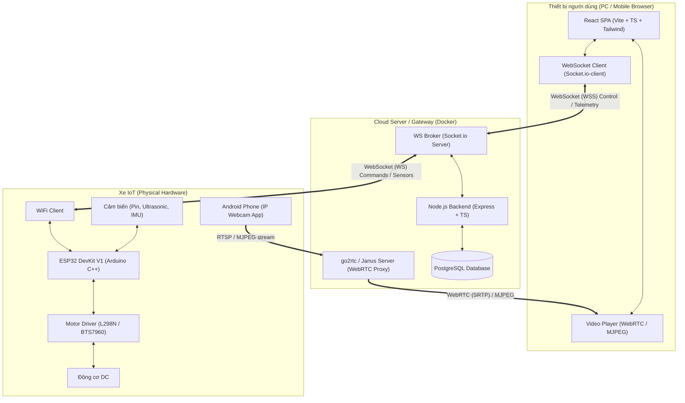
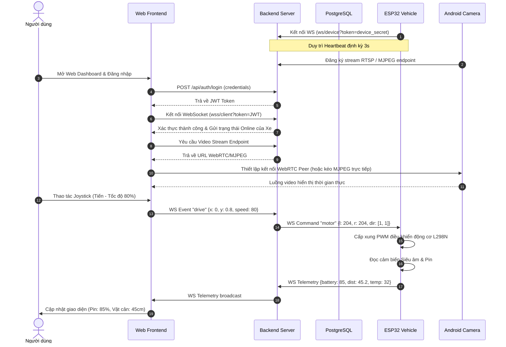
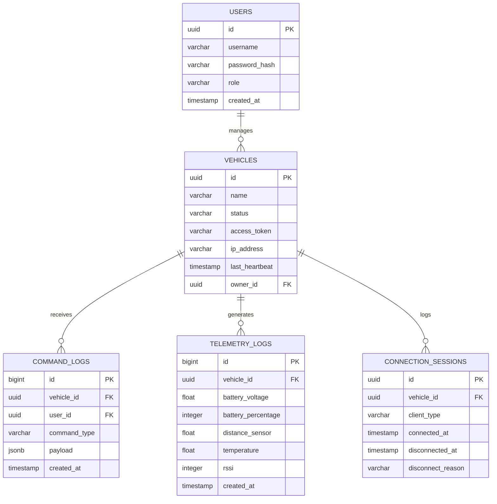
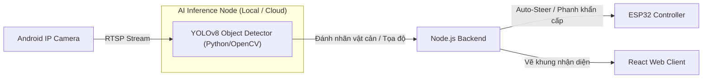

# KIẾN TRÚC VÀ THIẾT KẾ HỆ THỐNG: Ô TÔ ĐIỀU KHIỂN IOT CAMERA THỜI GIAN THỰC

Tài liệu này trình bày phân tích kiến trúc hệ thống chi tiết từ góc nhìn của một Senior Software Architect cho dự án xe điều khiển IoT có truyền hình camera thời gian thực với độ trễ cực thấp.

---

## 1. Kiến trúc tổng thể (Overall Architecture)

Hệ thống được thiết kế theo mô hình lai (Hybrid Architecture) kết hợp giữa kiến trúc Client-Server thông tin qua REST/WebSocket và kiến trúc truyền dẫn trực tiếp (Peer-to-Peer/Direct stream) cho phần Camera nhằm đảm bảo độ trễ điều khiển dưới 50ms và độ trễ video dưới 150ms.

### Sơ đồ kiến trúc hệ thống (System Architecture Diagram)



### Giải thích luồng dữ liệu (Data Flows)
1. **Luồng Điều khiển (Control Flow)**: Người dùng tương tác với Joystick/Nút bấm trên Web UI -> WebSocket Client gửi gói tin điều khiển (dạng JSON nhỏ hoặc Binary) -> Backend WS Broker -> Forward ngay lập tức đến ESP32 đang giữ kết nối TCP persistent -> ESP32 bóc tách dữ liệu và điều khiển chân PWM/GPIO cho L298N/BTS7960 điều khiển động cơ.
2. **Luồng Trạng thái (Telemetry Flow)**: ESP32 đọc định kỳ (ví dụ: 100ms/lần) cảm biến siêu âm, điện áp pin qua ADC -> Đóng gói gửi lên Backend thông qua WS -> Backend lưu trữ vào DB theo đợt (Batch Insert/Buffer để tránh quá tải DB) và đồng thời Broadcast đến tất cả Client đang kết nối.
3. **Luồng Video (Video Streaming Flow)**: Camera trên điện thoại Android (IP Webcam) truyền luồng RTSP/MJPEG về Media Server (go2rtc hoặc Janus) -> Media Server thực hiện chuyển đổi giao thức (Protocol translation) thành WebRTC để đảm bảo truyền qua môi trường internet không bị chặn bởi NAT và đạt độ trễ siêu nhỏ (<100ms) -> Trình duyệt Client giải mã trực tiếp bằng phần cứng thông qua API `RTCPeerConnection`.

---

## 2. Luồng hoạt động (System Workflows)

### Lưu đồ tuần tự tổng quát (General Sequence Diagram)



---

## 3. Phân chia module (Module Decomposition)

Hệ thống được thiết kế theo nguyên tắc Single Responsibility để dễ dàng bảo trì và mở rộng.

| Module | Thành phần chi tiết | Công nghệ chính | Vai trò |
| :--- | :--- | :--- | :--- |
| **Frontend** | Control UI, Video Stream Player, Settings, Charts | React, Vite, TS, Tailwind, Lucide Icons, ChartJS | Giao diện điều khiển, hiển thị video độ trễ thấp và hiển thị số liệu cảm biến |
| **Backend** | API Gateway, WS Broker, Session Manager, Logging | Node.js, Express, Socket.io, TypeScript | Quản lý định tuyến API, định tuyến lệnh điều khiển thời gian thực và quản lý phiên kết nối |
| **Firmware** | WiFi Manager, WS Client, Motor Controller, Telemetry Collector | ESP-IDF / Arduino Framework, WebSocketsClient, ArduinoJson | Nhận tín hiệu điều khiển PWM, đọc các chân cảm biến vật lý và gửi dữ liệu trạng thái ngược lại |
| **Database** | Relational Schema & Logs Buffer | PostgreSQL | Lưu trữ dữ liệu cấu hình xe, tài khoản người dùng và lịch sử cảm biến |
| **Camera** | RTSP/WebRTC Gateway | go2rtc / Janus Media Server | Tiếp nhận nguồn video RTSP từ Android và phân phối luồng WebRTC sang trình duyệt |

---

## 4. Thiết kế Database (Database Design - ERD)

Hệ thống sử dụng PostgreSQL để vừa lưu thông tin cấu hình quan hệ (Users, Vehicles) vừa xử lý tốt các log cảm biến dưới dạng Time-Series.



---

## 5. Thiết kế API (REST API Design)

Tất cả các API ngoại trừ `/api/auth/login` đều yêu cầu Bearer JWT Token ở header `Authorization`.

### 5.1. Authentication
* **POST /api/auth/login**
  - *Mô tả*: Đăng nhập hệ thống để nhận JWT Token.
  - *Request Body*:
    ```json
    {
      "username": "admin",
      "password": "strongpassword123"
    }
    ```
  - *Response (200 OK)*:
    ```json
    {
      "success": true,
      "token": "eyJhbGciOiJIUzI1NiIsIn...",
      "user": { "id": "uuid-1", "username": "admin", "role": "operator" }
    }
    ```
  - *Response (401 Unauthorized)*:
    ```json
    { "success": false, "message": "Invalid username or password" }
    ```

### 5.2. Vehicle Management
* **GET /api/vehicles**
  - *Mô tả*: Lấy danh sách các xe có trên hệ thống và trạng thái kết nối hiện tại.
  - *Response (200 OK)*:
    ```json
    [
      {
        "id": "7fa8-4b2a...",
        "name": "IoT Car Alpha",
        "status": "online",
        "ip_address": "192.168.1.15",
        "last_heartbeat": "2026-07-21T14:50:00Z"
      }
    ]
    ```

### 5.3. Telemetry & History
* **GET /api/vehicles/:id/telemetry**
  - *Mô tả*: Lấy dữ liệu cảm biến lịch sử phục vụ hiển thị biểu đồ.
  - *Query Params*: `limit=50`, `metric=battery|distance`
  - *Response (200 OK)*:
    ```json
    {
      "vehicle_id": "7fa8-4b2a...",
      "data": [
        { "timestamp": "2026-07-21T14:49:00Z", "battery": 82.5, "distance": 120.4, "rssi": -65 },
        { "timestamp": "2026-07-21T14:49:10Z", "battery": 82.4, "distance": 118.2, "rssi": -66 }
      ]
    }
    ```

---

## 6. Thiết kế WebSocket (Real-Time Control Protocol)

Để tối ưu hóa hiệu năng, giao tiếp WebSocket sử dụng các gói tin JSON rút gọn hoặc giao thức nhị phân tự định nghĩa.

### 6.1. Từ Client lên Server
* **Event: `drive`**
  - *Payload*:
    ```json
    {
      "x": 0.0,
      "y": 0.85,
      "speed": 80
    }
    ```
  - *Giải thích*: Người dùng đẩy joystick tiến về phía trước (`y` dương), xoay hướng thẳng (`x = 0`), tốc độ tối đa quy định 80%.

* **Event: `macro`**
  - *Payload*:
    ```json
    {
      "action": "stop_all"
    }
    ```

### 6.2. Từ Server xuống ESP32
* **Event: `motor`**
  - *Payload (Rút gọn tối đa dung lượng gói tin)*:
    ```json
    {
      "l": 216,
      "r": 216,
      "dl": 1,
      "dr": 1
    }
    ```
  - *Giải thích*: `l`/`r` là giá trị PWM (0-255) cho motor trái và phải. `dl`/`dr` là hướng quay (1: Tiến, 0: Lùi, -1: Dừng tự do).

### 6.3. Từ ESP32 lên Server
* **Event: `telemetry`**
  - *Payload*:
    ```json
    {
      "v": 11.8,
      "p": 85,
      "d": 45.2,
      "t": 34.5,
      "w": -62
    }
    ```
  - *Giải thích*: `v` = battery voltage, `p` = battery percentage, `d` = distance sensor (cm), `t` = internal temp (°C), `w` = wifi rssi (dBm).

---

## 7. Thiết kế giao diện (UI/UX Mockup Design)

Giao diện được thiết kế theo phong cách **Glassmorphism Dark Theme** (vải tối, viền mờ, hiệu ứng gương neon) để tạo cảm giác công nghệ cao (Sci-Fi Dashboard).

```
+-----------------------------------------------------------------------------------------+
| [WiFi: 92%] [Latency: 12ms]               IoT CAR DASHBOARD                [BATTERY: 84%] |
+------------------------------------+----------------------------------------------------+
|                                    | Telemetry Dashboard                                |
|  [LIVE CAMERA VIEW]                | +------------------------------------------------+ |
|  Giao diện phát camera WebRTC      | | Distance Sensor: 45.2 cm  (Warning: Obstacle)  | |
|  Độ phân giải: 720p @ 30FPS        | | Temperature: 34.5 C                            | |
|  Latency: 80ms                     | +------------------------------------------------+ |
|                                    | Biểu đồ Pin & Khoảng cách (Real-time chart)       |
|                                    | [~~~~~~~~~~ Chart ~~~~~~~~~~]                    |
|                                    |                                                    |
|  +------------------------------+  +----------------------------------------------------+
|  | Speed Index: [======>  ] 80% |  | Vehicle Control System                             |
|  +------------------------------+  |                                                    |
|                                    |        ( Tiến )                                    |
|                                    |           /\                                       |
|                                    |  (Trái) <    > (Phải)       [ Virtual Joystick ]   |
|                                    |           \/                                       |
|                                    |        ( Lùi )                                     |
|                                    |                                                    |
|  [Cam status: Online]              | Speed Limit Slider: [ 80% ]                        |
+------------------------------------+----------------------------------------------------+
```

---

## 8. Thiết kế ESP32 (Firmware Control Protocol)

Để nhận lệnh từ Backend, ESP32 có các lựa chọn:
1. **MQTT**: Thích hợp cho mạng IoT diện rộng, độ trễ không ổn định do đi qua Broker đám mây của bên thứ ba, cấu trúc publish-subscribe phức tạp.
2. **WebSocket Client**: Thích hợp điều khiển cục bộ lẫn internet, giữ kết nối TCP persistent trực tiếp, hỗ trợ truyền hai chiều, **độ trễ thấp nhất (<20ms)**.
3. **HTTP (REST)**: Overhead lớn do phải đóng mở TCP liên tục. Không thể dùng để điều khiển liên tục.
4. **UDP (Raw/OSC)**: Độ trễ thấp nhất nhưng không đảm bảo độ tin cậy của gói tin (Packet Loss), dễ bị mất cấu trúc điều khiển và khó cấu hình NAT traversal.

> [!IMPORTANT]
> **Đề xuất của Architect**: Chọn **WebSocket Client** chạy trên ESP32. Kết nối trực tiếp vào Node.js Backend. Lệnh điều khiển được cấu trúc dạng JSON rút gọn các trường dữ liệu để tăng tốc độ parse của thư viện `ArduinoJson` trên ESP32.

---

## 9. Đánh giá giải pháp Camera (Camera Options Comparison)

| Tiêu chí | Android IP Webcam (MJPEG) | RTSP Server (H.264) | WebRTC (SRTP/Opus) | ESP32-CAM (MJPEG) |
| :--- | :--- | :--- | :--- | :--- |
| **Độ trễ** | Thấp (150ms - 300ms) | Trung bình (1 - 2s) | Cực thấp (80 - 150ms) | Trung bình (200 - 400ms) |
| **Độ phân giải** | Cao (FullHD/720p) | Rất cao (FullHD) | Cao (720p) | Thấp (VGA/SVGA) |
| **CPU ESP32** | 0% (Không chạy trên ESP32) | 0% (Chạy trên Android) | 0% | 90% (Gây nghẽn hệ thống) |
| **Độ ổn định** | Cao (Ứng dụng chạy độc lập) | Rất cao | Cao (Hỗ trợ NAT Traversal) | Thấp (Dễ sập nguồn/nhiễu) |
| **Băng thông** | Cao (Do truyền tải JPEG liên tục)| Thấp | Rất thấp (H.264/VP8 compression) | Cao |

> [!TIP]
> **Đề xuất tối ưu**: 
> - **Giai đoạn phát triển thử nghiệm (Local)**: Dùng điện thoại Android cài app **IP Webcam** phát luồng MJPEG. Web App gọi trực tiếp URL của IP Webcam qua WiFi nội bộ.
> - **Giai đoạn hoàn thiện (Production/Internet)**: Cài đặt **go2rtc/Janus Media Server** trên Cloud Server để làm Proxy chuyển đổi luồng RTSP từ điện thoại Android thành luồng WebRTC phân phối cho Web client để tối ưu băng thông và giảm độ trễ tối đa.

---

## 10. Giải pháp bảo mật (Security Architecture)

1. **JSON Web Token (JWT)**: Client phải thực hiện login nhận token chứa thời hạn hết hạn ngắn (1 tiếng). Token này được đính kèm vào header khi gọi API và truyền qua query string khi bắt tay kết nối WebSocket (`wss://...`).
2. **WebSocket Security (WSS)**: Tất cả kết nối WebSocket bắt buộc chạy qua SSL/TLS (WSS) nhằm mã hóa gói tin trên đường truyền, tránh bị tấn công Man-in-the-Middle (MITM).
3. **Mã PIN thiết bị**: ESP32 gửi token định danh xác thực thiết bị được cấu hình cứng trong firmware khi kết nối với Backend. Chỉ thiết bị được cấp phép mới nhận lệnh.
4. **Failsafe System (Chống mất kiểm soát)**: Thiết kế một cơ chế kiểm tra tính liên tục của lệnh điều khiển. Nếu xe không nhận được tín hiệu WS ping/điều khiển từ backend quá `1.5 giây`, ESP32 tự động ngắt các chân điều khiển động cơ để dừng xe ngay lập tức, ngăn ngừa va chạm không mong muốn khi mất mạng.

---

## 11. Tối ưu hiệu năng (Performance Optimization)

1. **Throttling Event**: Phía React UI chỉ phát sinh sự kiện thay đổi điều khiển (Joystick) tối đa **25 - 30 FPS** (khoảng 33ms - 40ms gửi gói tin một lần) bằng cách dùng hàm `throttle` của Lodash. Việc này tránh làm quá tải hàng đợi của WebSocket và CPU xử lý của ESP32.
2. **WebRTC Media Flow**: Tránh chuyển mã (transcoding) video trên Server Backend. Sử dụng cơ chế WebRTC bypass để luồng video được giải mã trực tiếp bằng GPU trên thiết bị người dùng.
3. **DOM Virtualization & CSS Hardware Acceleration**: Dùng thuộc tính `transform: translate3d` cho joystick trên UI để ép GPU vẽ giao diện, giải phóng CPU giúp tăng độ phản hồi của nút điều khiển.

---

## 12. Xử lý lỗi (Fault Tolerance & Error Handling)

* **Mất kết nối WiFi trên ESP32**: Cài đặt thư viện tự động reconnect. Khi ngắt kết nối, xe dừng lập tức. Đèn LED chỉ thị trên ESP32 nhấp nháy báo lỗi.
* **Mất tín hiệu điều khiển giữa Backend và ESP32**: Backend phát hiện qua cơ chế Ping/Pong của WebSocket. Nếu quá 2 chu kỳ ping (6 giây) không phản hồi, Backend đánh dấu xe ở trạng thái `offline` trên UI của người dùng.
* **Mất luồng camera**: Client lắng nghe sự kiện onerror của thẻ `<video>` hoặc `` để hiện placeholder và tiến hành reload luồng video sau mỗi 3 giây.

---

## 13. Khả năng mở rộng (Scalability & AI Roadmap)



1. **AI Object Detection**: Nguồn camera RTSP sẽ được đưa đồng thời vào một server Python xử lý ảnh dùng YOLOv8 để phát hiện biển báo, người đi bộ hoặc làn đường. Kết quả nhận diện (khung bounding box) được trả về client thông qua WebSocket để vẽ đè lên video.
2. **Scale nhiều người dùng / nhiều xe**: Dùng **MQTT Broker (EMQX)** thay thế cho WS Broker của Node.js để quản lý hàng nghìn xe. Node.js backend lúc này chỉ đóng vai trò phân quyền và ghi log dữ liệu.

---

## 14. Lộ trình phát triển (Development Roadmap)

```
Giai đoạn 1: Mockup & UI (Hiện tại) ----> Giai đoạn 2: WebSocket & API Backend ----> Giai đoạn 3: ESP32 Firmware & Motor Driver ----> Giai đoạn 4: WebRTC & AI Integration
```

* **Giai đoạn 1: Thiết lập UI và Kết nối Camera (Tuần 1 - 2)**
  - *Mục tiêu*: Dựng giao diện điều khiển React SPA, tích hợp luồng phát video MJPEG từ IP Webcam và xây dựng bộ Joystick mô phỏng.
  - *Đầu ra*: Mã nguồn Frontend React hoàn chỉnh chạy cục bộ.
* **Giai đoạn 2: Lập trình Backend Node.js & WebSocket (Tuần 3)**
  - *Mục tiêu*: Viết API đăng nhập, tạo WS Broker trung trung chuyển lệnh điều khiển và nhận dữ liệu telemetry giả lập.
* **Giai đoạn 3: Lập trình ESP32 & Lắp ráp phần cứng (Tuần 4 - 5)**
  - *Mục tiêu*: Cấu hình ESP32 kết nối WiFi và WebSocket Backend, điều hướng motor driver L298N chạy theo tín hiệu nhận được.
* **Giai đoạn 4: Tích hợp cơ chế WebRTC cho Camera & Triển khai Docker (Tuần 6)**
  - *Mục tiêu*: Triển khai go2rtc, đóng gói toàn bộ hệ thống bằng Docker Compose và kiểm thử độ trễ internet.

---

## 15. Cấu trúc thư mục dự án (Folder Structure)

```
duan_esp32/
├── docker-compose.yml
├── README.md
├── docs/
│   └── system_architecture.md
├── frontend/                 # React SPA (Vite + TS + Tailwind)
│   ├── package.json
│   ├── tsconfig.json
│   ├── vite.config.ts
│   ├── tailwind.config.js
│   ├── postcss.config.js
│   ├── index.html
│   └── src/
│       ├── main.tsx
│       ├── index.css
│       ├── components/       # UI Components (Joystick, CameraPlayer, StatusPanel, TelemetryCharts)
│       ├── hooks/            # Custom React hooks (useWebSocket, useCamera)
│       └── pages/            # Dashboard, Login, Settings pages
├── backend/                  # Node.js + Express + Socket.io Server
│   ├── package.json
│   ├── tsconfig.json
│   ├── src/
│   │   ├── app.ts
│   │   ├── controllers/      # Route controllers (Auth, Vehicle, Log)
│   │   ├── services/         # Business logic & DB Repository interaction
│   │   ├── sockets/          # Socket.io handlers & Broker logic
│   │   └── models/           # DB Models (PostgreSQL schemas)
└── firmware/                 # ESP32 C++ Code
    ├── platformio.ini
    └── src/
        ├── main.cpp          # Main setup, Loop, WiFi & WS Client tasks
        ├── config.h          # Pins mapping, WiFi Credentials, API Server addresses
        └── motor.h           # Motor driver control functions (L298N/BTS7960 PWM mapping)
```

---

## 16. Coding Convention & Best Practices

1. **Git Commit Message**: Tuân thủ chuẩn [Conventional Commits](https://www.conventionalcommits.org/):
   - `feat(frontend): add joystick component`
   - `fix(firmware): fix pwm motor jittering on esp32`
   - `docs: update system architecture design`
2. **SOLID & Clean Code**: 
   - Phần Backend chia tầng rõ ràng: Controller -> Service -> Model (Repository pattern) để dễ thay thế DB MySQL/PostgreSQL.
   - Các API controller không được can thiệp sâu vào DB mà phải đi qua Service Layer.
3. **TypeScript Strict Mode**: Không sử dụng `any`, định nghĩa kiểu rõ ràng cho tất cả tham số, DTO (Data Transfer Objects) và WebSocket Event Payload.

---

## 17. Phân tích rủi ro & Cách khắc phục (30 Risks & Mitigations)

### Nhóm 1: Rủi ro phần cứng & Cơ khí (Hardware & Mechanical Risks)
1. **Xe bị chập mạch nguồn**:
   - *Nguyên nhân*: Dây nguồn động cơ bị hở tiếp xúc với sườn xe kim loại hoặc đấu ngược cực pin.
   - *Ảnh hưởng*: Cháy ESP32, nổ tụ motor driver hoặc hỏng pin LiPo.
   - *Khắc phục*: Sử dụng ống co nhiệt bọc các mối hàn, lắp cầu chì bảo vệ 5A dòng tải của pin trước mạch công suất.
2. **Động cơ DC chạy giật cục hoặc không đều**:
   - *Nguyên nhân*: Thiếu tụ lọc nhiễu ở hai cực động cơ DC.
   - *Ảnh hưởng*: Nhiễu điện từ lan truyền ngược lại nguồn nuôi ESP32 làm reset ESP32 liên tục.
   - *Khắc phục*: Hàn thêm tụ đất (tụ gốm 104 - 0.1uF) song song ở mỗi động cơ DC.
3. **Mạch L298N quá nhiệt**:
   - *Nguyên nhân*: Ép xe chạy vượt tải trọng hoặc sụt áp pin quá nhiều.
   - *Ảnh hưởng*: Mạch L298N ngắt bảo vệ nhiệt làm xe dừng đột ngột hoặc cháy chip cầu H.
   - *Khắc phục*: Gắn thêm tản nhiệt nhôm lớn hơn hoặc thay thế bằng mạch cầu H hiệu suất cao hơn (BTS7960 / TB6612FNG).
4. **Pin sụt áp đột ngột (Brownout Reset)**:
   - *Nguyên nhân*: ESP32 sử dụng chung nguồn với motor driver mà không có bộ lọc ổn áp tốt. Khi động cơ khởi động, dòng khởi động lớn rút hết điện áp.
   - *Ảnh hưởng*: Điện áp cấp cho ESP32 tụt dưới 2.7V làm chip tự động reset.
   - *Khắc phục*: Tách nguồn riêng (Ví dụ: 1 viên pin 18650 qua mạch Buck 5V nuôi ESP32, 2 viên pin 18650 mắc nối tiếp cấp nguồn động cơ).
5. **Hỏng cell pin LiPo do xả quá mức (Over-discharge)**:
   - *Nguyên nhân*: Xe chạy liên tục không kiểm tra điện áp pin, xả pin dưới ngưỡng an toàn 3.0V/cell.
   - *Ảnh hưởng*: Pin bị phồng, mất khả năng tích điện và tăng nguy cơ cháy nổ khi sạc lại.
   - *Khắc phục*: Viết code đo điện áp pin qua chân Analog (cầu phân áp điện trở) và tự động ngắt kết nối, phát cảnh báo còi buzzer khi điện áp pin < 3.2V/cell.
6. **Bánh xe bị trượt/Lệch hướng**:
   - *Nguyên nhân*: Sai số cơ học khi lắp ráp khung xe hoặc hệ số ma sát giữa các bánh xe không đều.
   - *Ảnh hưởng*: Xe không đi thẳng dù truyền lệnh đi thẳng.
   - *Khắc phục*: Viết hàm hiệu chỉnh sai số (Calibrate offset) ở ESP32 để giảm nhẹ PWM của bánh chạy nhanh hơn hoặc dùng cảm biến IMU (MPU6050) để điều hướng góc quay bằng giải thuật PID.
7. **Lỏng giắc cắm trên xe (Jumper wires)**:
   - *Nguyên nhân*: Chấn động cơ học khi xe di chuyển trên bề mặt gồ ghề.
   - *Ảnh hưởng*: Mất tín hiệu điều khiển động cơ hoặc cảm biến.
   - *Khắc phục*: Hàn chết các điểm kết nối chính hoặc sử dụng giắc cắm khóa chốt (Molex/JST).
8. **Nhiễu cảm biến siêu âm**:
   - *Nguyên nhân*: Sóng siêu âm dội từ tường xiên hoặc bề mặt mềm hấp thụ âm thanh.
   - *Ảnh hưởng*: Đo sai khoảng cách, không phát hiện được vật cản dẫn tới va đập.
   - *Khắc phục*: Sử dụng bộ lọc nhiễu phần mềm (Median Filter) lấy trung bình 5 lần đo liên tiếp và bỏ các điểm đột biến.
9. **Cân nặng phân bố không đều**:
   - *Nguyên nhân*: Pin và điện thoại Android (làm camera) lắp lệch về một bên sườn xe.
   - *Ảnh hưởng*: Xe dễ bị lật khi rẽ gấp ở tốc độ cao.
   - *Khắc phục*: Phân bố pin cân bằng ở giữa, thiết kế giá đỡ camera trung tâm.
10. **Chân cắm GPIO ESP32 bị chết**:
    - *Nguyên nhân*: Chân GPIO kết nối trực tiếp với ngõ vào L298N bị dội dòng ngược áp cao.
    - *Ảnh hưởng*: Mất khả năng điều khiển PWM cho motor.
    - *Khắc phục*: Sử dụng điện trở hạn dòng 220 Ohm giữa chân GPIO ESP32 và chân ngõ vào Motor Driver.

### Nhóm 2: Rủi ro truyền thông & Mạng (Network & Latency Risks)
11. **Mất gói tin điều khiển (Packet Loss)**:
    - *Nguyên nhân*: Mạng WiFi nội bộ bị nghẽn hoặc trùng kênh sóng (Channel congestion).
    - *Ảnh hưởng*: Xe không phản hồi tức thời, phản ứng chậm chạp gây đâm đụng.
    - *Khắc phục*: Chạy điều khiển qua WebSocket dùng TCP để đảm bảo kiểm soát lỗi truyền tin, đồng thời tối ưu hóa băng thông bằng payload nhỏ.
12. **Trễ mạng tăng cao (Latency Spike/Jitter)**:
    - *Nguyên nhân*: Khoảng cách giữa xe và router WiFi quá xa, suy hao tín hiệu tường chắn.
    - *Ảnh hưởng*: Lệnh điều khiển bị dồn cục, đột ngột xe lao đi nhanh sau đó đứng im.
    - *Khắc phục*: Triển khai thuật toán Failsafe: đo thời gian trễ của gói tin nhận được. Nếu trễ > 200ms, lập tức giảm tốc độ xe về 0.
13. **Địa chỉ IP của ESP32 bị thay đổi liên tục**:
    - *Nguyên nhân*: Router WiFi cấp phát IP động thông qua DHCP định kỳ.
    - *Ảnh hưởng*: Backend và Web client không thể tìm thấy xe để gửi lệnh trực tiếp.
    - *Khắc phục*: Cấu hình ESP32 kết nối WebSocket Client chủ động trỏ tới địa chỉ IP tĩnh của Server Backend (hoặc dùng tên miền mDNS như `iotcar.local`).
14. **Luồng video MJPEG ngốn băng thông lớn**:
    - *Nguyên nhân*: Định dạng MJPEG truyền từng frame ảnh JPEG thô, không nén chênh lệch chuyển động.
    - *Ảnh hưởng*: Làm nghẽn băng thông WiFi nội bộ, dẫn tới trễ tín hiệu điều khiển của WebSocket.
    - *Khắc phục*: Chuyển đổi luồng camera sang giao thức WebRTC (H.264/VP8 nén động) khi triển khai thực tế.
15. **Sự cố NAT/Firewall khi chạy điều khiển qua Internet**:
    - *Nguyên nhân*: Mạng WiFi gia đình nằm sau NAT của nhà mạng (CGNAT).
    - *Ảnh hưởng*: Người dùng ở mạng ngoài (ví dụ 4G) không kết nối trực tiếp được với xe.
    - *Khắc phục*: Sử dụng máy chủ trung gian làm Relay (TURN Server cho WebRTC, và WSS Cloud Server cho WebSocket).
16. **Tấn công giả mạo lệnh điều khiển (Replay Attack)**:
    - *Nguyên nhân*: Kẻ xấu chặn bắt gói tin WebSocket không mã hóa rồi gửi lại lệnh di chuyển.
    - *Ảnh hưởng*: Mất quyền điều khiển xe an toàn.
    - *Khắc phục*: Gắn timestamp kèm khóa HMAC bảo mật trong mỗi frame điều khiển, bác bỏ các lệnh có mốc thời gian lệch quá 1 giây.
17. **Hiện tượng "Head-of-Line Blocking" trên WebSocket**:
    - *Nguyên nhân*: Gói tin trước bị lỗi mất tích làm ngắt toàn bộ hàng đợi TCP phía sau.
    - *Ảnh hưởng*: Trễ dồn tích khiến xe nhận chuỗi lệnh muộn.
    - *Khắc phục*: Tách luồng dữ liệu cảm biến (ít quan trọng) và dữ liệu lái xe (tối quan trọng) ra hai kết nối hoặc tối ưu kích thước gói tin.
18. **Router WiFi ngắt kết nối do quá tải client**:
    - *Nguyên nhân*: Router giá rẻ trong phòng thí nghiệm chịu tải quá nhiều thiết bị.
    - *Ảnh hưởng*: Tất cả hệ thống mất kết nối.
    - *Khắc phục*: Cấu hình mạng WiFi riêng (Access Point độc lập) dành riêng cho xe và máy tính điều khiển.
19. **Bất đối xứng luồng Video và Control**:
    - *Nguyên nhân*: Video bị trễ 200ms nhưng lệnh điều khiển trễ chỉ 10ms.
    - *Ảnh hưởng*: Người dùng nhìn thấy xe sắp đâm tường trên màn hình nhưng thực tế xe đã đâm tường rồi.
    - *Khắc phục*: Đồng bộ hóa hiển thị hoặc thiết lập khoảng cách an toàn phần cứng thông qua cảm biến siêu âm tự phanh độc lập trên ESP32.
20. **Không bắt tay được SSL/TLS trên ESP32**:
    - *Nguyên nhân*: ESP32 không đủ RAM để xử lý thuật toán mã hóa TLS quá phức tạp hoặc chứng chỉ SSL hết hạn.
    - *Ảnh hưởng*: Không kết nối được cổng HTTPS/WSS của Backend.
    - *Khắc phục*: Cấu hình bỏ qua xác thực chuỗi chứng chỉ (Insecure mode) trên ESP32 hoặc đặt server Node.js phía sau Reverse Proxy (Nginx) xử lý TLS và forward HTTP/WS thô nội bộ cho ESP32.

### Nhóm 3: Rủi ro phần mềm & Hệ thống (Software & Systems Risks)
21. **Tràn bộ nhớ RAM trên ESP32**:
    - *Nguyên nhân*: Rò rỉ bộ nhớ do khai báo chuỗi `String` liên tục trong hàm `loop()` mà không giải phóng.
    - *Ảnh hưởng*: ESP32 bị crash bất thường sau vài phút hoạt động.
    - *Khắc phục*: Dùng kiểu dữ liệu `char[]` tĩnh, hạn chế tối đa việc cộng chuỗi `String`, bật công cụ theo dõi bộ nhớ `ESP.getFreeHeap()`.
22. **Race Condition khi nhiều người dùng cùng bấm nút điều khiển**:
    - *Nguyên nhân*: Hệ thống cho phép nhiều Client gửi lệnh lái xe đồng thời tới 1 xe.
    - *Ảnh hưởng*: Xe di chuyển hỗn loạn (vừa tiến vừa lùi) làm hỏng động cơ.
    - *Khắc phục*: Backend triển khai cơ chế khóa phiên (Session Lock) - Chỉ một người dùng được cấp quyền lái xe tại một thời điểm (Driver Role Lock).
23. **Rò rỉ kết nối database (Connection Leak)**:
    - *Nguyên nhân*: Viết code ghi log cảm biến không đóng kết nối PostgreSQL hoặc tạo quá nhiều kết nối mới mỗi khi có sự kiện cảm biến gửi lên.
    - *Ảnh hưởng*: Server hết tài nguyên kết nối, sập dịch vụ REST API.
    - *Khắc phục*: Sử dụng Database Connection Pooling (`pg-pool`) và tối ưu hóa ghi log theo lô (Batch logging).
24. **React bị treo đơ giao diện**:
    - *Nguyên nhân*: Rerender liên tục khi nhận dữ liệu cảm biến tần suất cao (ví dụ 10ms/lần).
    - *Ảnh hưởng*: Giao diện không phản hồi thao tác lái của người dùng.
    - *Khắc phục*: Sử dụng React `useRef` để lưu giữ giá trị cảm biến thô và chỉ cập nhật lên DOM các thông số cần thiết thông qua hàm điều tiết (Debounce/Throttle) hoặc render trực tiếp lên Canvas.
25. **Lỗi tràn số (Integer Overflow) trên ESP32**:
    - *Nguyên nhân*: Dùng biến kiểu `millis()` tính thời gian chạy mà không xử lý trường hợp biến tràn (sau khoảng 50 ngày).
    - *Ảnh hưởng*: Sai lệch thời gian chạy các tiến trình phụ.
    - *Khắc phục*: Sử dụng toán tử trừ không dấu `(currentMillis - previousMillis >= interval)` để triệt tiêu lỗi tràn số.
26. **Ứng dụng Camera Android tự động sleep**:
    - *Nguyên nhân*: Cơ chế tiết kiệm pin của HĐH Android tắt tiến trình chạy ngầm của IP Webcam.
    - *Ảnh hưởng*: Mất nguồn cấp video bất ngờ.
    - *Khắc phục*: Cấu hình Android tắt tối ưu hóa pin cho ứng dụng IP Webcam, cắm sạc trực tiếp từ pin sạc dự phòng trên xe.
27. **Tổn hao hiệu năng do parse JSON ở ESP32**:
    - *Nguyên nhân*: File JSON điều khiển chứa quá nhiều key dài dòng, ESP32 tốn thời gian giải mã.
    - *Ảnh hưởng*: Chậm thời gian đáp ứng lệnh điều khiển động cơ.
    - *Khắc phục*: Sử dụng thư viện `ArduinoJson` bản mới nhất và tối ưu hóa cấp phát bộ nhớ tĩnh bằng `StaticJsonDocument`.
28. **Hệ thống tệp Docker bị tràn dung lượng**:
    - *Nguyên nhân*: Ghi file log hệ thống (Docker logs) quá nhiều mà không tự động xoay vòng.
    - *Ảnh hưởng*: Đĩa cứng máy chủ bị đầy, ứng dụng ngưng hoạt động.
    - *Khắc phục*: Cấu hình ghi log xoay vòng trong `docker-compose.yml` giới hạn kích thước file log tối đa 10MB.
29. **Chặn tài nguyên do CORS ở Frontend**:
    - *Nguyên nhân*: Cổng React UI (localhost:5173) khác cổng Backend API (localhost:3000) và camera stream.
    - *Ảnh hưởng*: Trình duyệt chặn không cho lấy cấu hình hoặc hiển thị ảnh chụp camera.
    - *Khắc phục*: Cấu hình CORS middleware hợp lệ trên Backend Node.js cho phép nguồn gốc xuất phát của client.
30. **Sập nguồn camera do điện thoại quá nóng**:
    - *Nguyên nhân*: Điện thoại Android chạy camera liên tục dưới trời nắng hoặc gần linh kiện phát nhiệt của xe.
    - *Ảnh hưởng*: Camera tắt do cơ chế bảo vệ quá nhiệt của điện thoại.
    - *Khắc phục*: Thiết kế khe thoát gió xung quanh điện thoại, không dán keo hoặc ốp nhựa kín lưng điện thoại.

---

## 18. Kế hoạch kiểm thử (Testing Strategy)

```
[Unit Test] (Code logic) -> [Integration Test] (REST API & WS) -> [Firmware Loop Test] (Hardware pins) -> [Latency E2E Test] (Timing)
```

1. **Unit Test (Frontend & Backend)**: Sử dụng Jest/Vitest kiểm tra các helper function định dạng gói tin, tính toán tọa độ Joystick sang giá trị PWM.
2. **Integration Test**: Giả lập WebSocket Client kết nối đến Backend, gửi chuỗi lệnh lái liên tục và xác thực dòng ghi dữ liệu vào PostgreSQL Database.
3. **Firmware Test (Hardware-in-the-Loop)**: Đo điện áp tại chân ngõ ra PWM của ESP32 bằng đồng hồ vạn năng khi gửi lệnh qua WebSocket để kiểm tra tính chính xác của thuật toán chuyển đổi PWM.
4. **Latency E2E Test**: Chèn mốc thời gian (timestamp) lúc người dùng click chuột -> tính thời điểm ESP32 nhận được lệnh -> đo đạc tổng thời gian trễ và thống kê độ trễ trung bình.

---

## 19. Đánh giá công nghệ thay thế (Alternative Technologies)

1. **Express vs NestJS**:
   - *Đánh giá*: NestJS cung cấp kiến trúc Modular rõ ràng hơn cho dự án quy mô doanh nghiệp nhưng khá nặng nề và phức tạp đối với sinh viên học tập.
   - *Chọn*: **Express** vì nhẹ, dễ học, cấu hình nhanh và hoàn toàn đáp ứng tốt các dự án IoT trung bình.
2. **React vs Next.js**:
   - *Đánh giá*: Next.js mạnh về SEO và Server-Side Rendering (SSR) nhưng không cần thiết cho một ứng dụng Dashboard điều khiển thời gian thực vốn chạy hoàn toàn ở Client-side.
   - *Chọn*: **React (qua Vite)** để tối ưu dung lượng build, khởi động nhanh và hiệu năng xử lý client tốt.
3. **MySQL vs PostgreSQL**:
   - *Đánh giá*: Cả hai đều rất tốt, nhưng PostgreSQL hỗ trợ kiểu dữ liệu JSONB mạnh mẽ hơn và quản lý dữ liệu Time-series tốt hơn để lưu telemetry từ xe.
   - *Chọn*: **PostgreSQL**.
